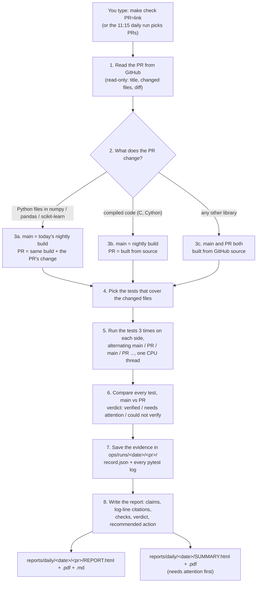

# Proof-of-Change

**Don't just read a pull request. Run it.**

Proof-of-Change takes a proposed change to an open-source Python library (a *pull request*, or "PR") and runs the
library's own tests twice: once without the change and once with it, three times each. It compares the results test by
test and writes a short report for a person to read, with a verdict (VERIFIED, NEEDS ATTENTION or COULD NOT VERIFY),
a recommended action, and a link to the exact log line behind every statement. It only gives advice: it never
comments on GitHub and never blocks anyone's change.

> New words are explained the first time they appear. There is also a [glossary](#glossary) at the end.

**Contents:** [Setup](#1-one-time-setup-on-a-mac) · [Check one PR](#2-check-one-pr) ·
[Daily run](#3-the-daily-run) · [How a report is made](#4-exactly-how-a-report-gets-generated) ·
[Read a report](#5-how-to-read-a-report) · [Where files live](#6-where-files-live) ·
[Troubleshooting](#7-troubleshooting) · [What it never does](#8-what-it-never-does) · [Technical docs](#9-technical-details)

---

## 1. One-time setup on a Mac

You do this once. It takes about 10 minutes. You will type commands into **Terminal**, the Mac's text window for
commands.

**Open Terminal:** press `⌘ Command` + `Space`, type `Terminal`, press `Return`. A window with a blinking cursor opens.
In this guide, a grey box like this is something to type. Type it (or copy and paste it) and press `Return`.

### Step 1: Install the Mac developer tools (git and make)

*git* downloads code; *make* runs the short commands this project uses.

```bash
xcode-select --install
```

- **What you should see:** a pop-up asking to install "command line developer tools". Click **Install** and wait
  until it says it is done (5 to 10 minutes).
- **If it says** `command line tools are already installed`: good, nothing to do. Go to step 2.

### Step 2: Install Python 3.12

*Python* is the programming language Proof-of-Change is written in. You need version 3.11 or newer.

1. Open <https://www.python.org/downloads/macos/> in your web browser.
2. Download the latest **Python 3.12** "macOS 64-bit universal2 installer" and open it. Click through the
   installer (Continue, Agree, Install).
3. Back in Terminal, check it worked:

```bash
python3 --version
```

- **What you should see:** `Python 3.12.something` (3.11 or 3.13 are fine too).
- **If you see** `Python 3.9.6` (the old version that comes with the Mac): close Terminal completely (`⌘ Q`), open it
  again and retry. If it still says 3.9, use `python3.12` instead of `python3` in step 4:
  `make setup PYTHON=python3.12`.

### Step 3: Download Proof-of-Change

This makes a folder called `Proof-of-change` in your home folder and moves into it.

```bash
cd ~
git clone https://github.com/aritracodesbad123/Proof-of-change.git
cd Proof-of-change
```

- **What you should see:** `Cloning into 'Proof-of-change'...`, possibly a few progress lines, and then the prompt
  comes back with no error.
- **If it says** `destination path 'Proof-of-change' already exists`: you downloaded it before. Just run
  `cd ~/Proof-of-change` and then `git pull` to get the newest version.

> Until pull request #1 is merged, the code lives on a branch. Also type `git switch feat/integrate-golden`.
> You should see `Switched to a new branch 'feat/integrate-golden'` (and a line saying it is set up to track
> `origin/feat/integrate-golden`). After the merge, skip this.

### Step 4: Install Proof-of-Change

This creates a private Python environment (a *venv*, a folder called `.venv` that keeps this project's add-ons away
from the rest of your Mac) and installs everything into it.

```bash
make setup
```

- **What you should see** (after about a minute), as the last line:
  `SETUP OK: Proof-of-Change is installed. Next: make check PR=<pull request link>`
- **If you see** `Python 3.9.6 is too old`: go back to step 2.
- Anything else: see [Troubleshooting](#7-troubleshooting).

### Step 5 (optional): Install Google Chrome for PDF reports

Reports are always made as web pages (HTML). If **Google Chrome** is installed in your Applications folder, a PDF copy
is made too. Get it from <https://www.google.com/chrome/> if you want PDFs.

### Step 6 (optional): Self-check

```bash
make test
```

- **What you should see** at the end: `SELF-CHECK OK`. Before that, lines such as `All checks passed!`,
  `no external side effects found`, `... passed` and `"recommendation": "APPROVE"`.

**Every time you come back later:** open Terminal and type `cd ~/Proof-of-change` first. That's all; setup is
never needed again.

---

## 2. Check one PR

1. Find the PR on GitHub and copy its link from the browser's address bar. It looks like
   `https://github.com/numpy/numpy/pull/32940`.
2. In Terminal (inside `~/Proof-of-change`), type `make check PR=` followed by the link:

```bash
make check PR=https://github.com/numpy/numpy/pull/32940
```

- **What you should see** (the first time takes a few minutes because test environments are downloaded; later about
  1 minute per PR):

```
[numpy/numpy] priority 1: selected [32940]
  testing #32940 BUG: fix nanquantile dtype for all-NaN first slice ...
    -> verified: 3 new test(s) pass, 1280 unchanged (48.5s)
...
DONE. Open this file to read the results:
  /Users/you/Proof-of-change/reports/daily/2026-10-10-check-0621/SUMMARY.html
```

3. Open the report:

```bash
make open
```

Your browser opens the summary page. Click **HTML** (or **PDF**) next to the PR to read its full report.

- **If it says** `not a GitHub pull request link`: the link must contain `/pull/` and a number. Copy it again from
  the PR's page.
- **If the verdict is COULD NOT VERIFY:** the check itself failed (for example, the change needs a C compiler).
  The report's "What went wrong and how to fix it" section says why. This is not a judgement of the PR.

Works best for **numpy, pandas and scikit-learn** (the default libraries). Other pure-Python libraries on GitHub
usually work too. They are downloaded and built from their source code, which takes longer.

---

## 3. The daily run

Every day, on the shared machine, with times in India Standard Time (IST):

| Time | Who | What happens |
|---|---|---|
| **10:15 AM** | Jonathan | Adds or updates libraries in the tracked-libraries list. He can also pick specific PRs to test that day. |
| **11:15 AM** | Nathan (the ops bot) | Runs the daily check. For each tracked library it takes up to 3 open PRs that changed since yesterday (or Jonathan's picks) and tests each one as in section 2. |
| after the run | you | Open `reports/daily/<today's date>/SUMMARY.html`. PRs that need a decision are listed first. |

You can also start the same run yourself on your Mac:

```bash
make daily
```

On your Mac it uses the starting list in `ops/tracked-libraries.csv` (numpy, pandas, scikit-learn). Jonathan's list
lives on the shared machine. It takes about 1 to 2 minutes per PR, so expect 10 to 20 minutes, and it ends with the
same `DONE. Open this file...` line.

---

## 4. Exactly how a report gets generated

From a PR link to the HTML/PDF in `reports/`, in order:



1. **Read the PR.** Proof-of-Change downloads the PR's title, the list of changed files and the change itself
   (the *diff*) from GitHub. It only reads; it never writes to GitHub.
2. **Decide how to build the two sides.** *main* is the library as it is today, and *PR* is the library with the
   change. Step 3 is chosen automatically from the files the PR touches.
3. **Build both sides** in throw-away environments under `ops/work/`, which are deleted afterwards.
4. **Pick tests.** It uses the test files that belong to the changed code, for example `test_rolling.py` for
   `rolling.py`.
5. **Run the tests 3 times per side,** alternating, with one CPU thread, so a test that fails only now and then
   (*flaky*) is caught and not mistaken for a real change.
6. **Compare.** Each test's result on main is compared with its result on the PR. Rules written as plain code (not AI)
   decide the verdict.
7. **Save the evidence:** `record.json` (what was done and found) and every raw test log.
8. **Write the report.** For each PR it builds the claims table, finds the exact log line behind every claim, re-reads
   each line to make sure it is really there, runs its own safety checks, and picks the verdict, recommended action
   and confidence. Then it writes the HTML, the PDF (if Chrome is installed) and a Markdown copy, plus one summary
   page for the whole run.

---

## 5. How to read a report

Open `SUMMARY.html` first. It lists every PR, with the ones that need a decision at the top. Click **HTML** or **PDF**
to open one PR's report. Each report reads top to bottom:

**The verdict banner** (the coloured box at the top):

| Verdict | Colour | Means |
|---|---|---|
| **VERIFIED** | green | The tests behave the same or better with the change. |
| **NEEDS ATTENTION** | amber | The check worked and found a difference a person should look at. |
| **COULD NOT VERIFY** | grey | The check itself didn't finish properly, so there's no conclusion about the PR. |

**Recommended action** (the small badge in the banner):

| Action | What to do |
|---|---|
| **Approve** | Nothing found. You can approve. |
| **Approve with notes** | Fine, but read the notes under "What went wrong" first (for example a flaky test). |
| **Reject** | Don't approve as is. Something changed that the PR doesn't explain. |
| **Re-run** | Don't decide yet. Fix the problem described in the report and run the check again. |

**Confidence:** *High* means every safety check passed. *Medium* means some warnings, listed in the report. *Low*
means the check didn't finish.

**The sections, in order:**

| Section | What it tells you |
|---|---|
| Summary in plain English | Three lines: what the PR says it does, what we saw, what you should do. |
| Claims vs reality | Each claim, whether it held up (*proven*, *false*, *not testable*, or an *unmentioned change*), and the **log line** that proves it. Click the log line to see the raw evidence. |
| What changed in behavior | Counts of tests that stayed the same, newly pass, newly fail, went missing, or were flaky, with examples. |
| What went right | The checks that passed. |
| What went wrong and how to fix it | Each problem, with the fix next to it. |
| Evals and guardrails (Nathan) | The safety checks on the run itself: 3 runs per side, one thread, nothing posted to GitHub, every citation real. |
| Checklist | Four things to tick before deciding. |
| Rerun command | The exact command to run this check again. |
| Evidence links | The PR, its diff, and every log and data file. |
| Glossary | The words used in the report. |

**To approve or reject:** there's no button. Proof-of-Change doesn't touch GitHub. You record your decision with one
command, and the report then shows "Decision recorded: ... by you". The report's Checklist section shows the exact
command for that PR. For example:

```bash
make decide REPORT=reports/daily/2026-10-10-check-0621/numpy-32940 DECISION=approve
make decide REPORT=reports/daily/2026-10-10-check-0621/numpy-32940 DECISION=reject NOTE="breaks rounding"
```

`DECISION` can be `approve`, `approve_with_notes`, `reject` or `re_run`. The folder is the one that contains that PR's
`REPORT.html`. If you want to tell the PR's authors, you do that yourself on GitHub. Proof-of-Change never does it
for you.

---

## 6. Where files live

Everything is inside the `Proof-of-change` folder (on your Mac: `~/Proof-of-change`).

| Where | What |
|---|---|
| `reports/daily/<date>/SUMMARY.html` | **Start here.** One page per run, needs-attention first. Also `.pdf` and `.md`. |
| `reports/daily/<date>/<pr>/REPORT.html` | The full report for one PR (also `.pdf`, `.md`). `DECISION.json` holds your decision. |
| `ops/runs/<date>/<pr>/` | The raw evidence: `record.json`, `pytest-main-1.log` ... `pytest-pr-3.log`, the diff, setup logs. |
| `ops/runs/<date>/REPORT.md` | The run's technical log (what was picked, skipped, how long it took). |
| `ops/tracked-libraries.csv` | The starting list of libraries for `make daily` on your Mac. |
| `reports/samples/golden-v1/` | Example reports for three known cases, kept in git. |
| `docs/` | Technical documents (see section 9). |

A check made with `make check` goes in a folder named like `2026-10-10-check-0621` (date, then the time). The daily
run uses just the date. These folders stay on your computer only. They are never uploaded.

---

## 7. Troubleshooting

| What you see | What it means | What to do |
|---|---|---|
| `xcode-select: error: command line tools are already installed` | Already done. | Go on to the next step. |
| `git: command not found` or `make: command not found` | The Mac developer tools are missing. | Run `xcode-select --install` (setup step 1). |
| `python3: command not found` | Python isn't installed. | Setup step 2. |
| `Python 3.9.6 is too old` | `python3` is still the Mac's built-in old Python. | Close and reopen Terminal, or use `make setup PYTHON=python3.12`. |
| `Not set up yet: run 'make setup' first.` | You're in the right folder, but setup hasn't run. | `make setup`. |
| `make: *** No rule to make target 'check'` or `No such file or directory` | You're not in the project folder. | `cd ~/Proof-of-change` and try again. |
| `Give the pull request link, e.g.: make check PR=...` | `PR=` was left out. | Add `PR=` and the link, with no spaces around `=`. |
| `not a GitHub pull request link` | The link isn't a PR link. | Copy the link from the PR page; it must contain `/pull/<number>`. |
| `GitHub rate limit hit` | GitHub allows 60 anonymous reads per hour. | Wait an hour. If it happens often, ask Nathan about a read-only GitHub token. |
| `Stopped: only N GB of free disk space` | Test environments need about 20 GB free. | Free up disk space and try again. |
| `note: no Chrome/Chromium found, so no PDFs` | Chrome isn't installed. HTML reports are still made. | Install Google Chrome (setup step 5) and run the check again. |
| Verdict **COULD NOT VERIFY**, reason `source build ... failed` | The PR changes C code and couldn't be compiled. | Normal for some PRs. The report says why. Try again in a day or two (a newer nightly build may help). |
| Verdict **COULD NOT VERIFY**, reason `patch does not apply` | The PR is based on older code than today's nightly build. | Nothing to fix on your side. Try again later. |
| `make open` prints a path but no browser opens | The browser didn't start. | In Finder, press `⌘ Shift G`, paste the printed path, and double-click the file. |
| The first `make check` is slow | It downloads test environments (several hundred MB). | Later checks are much faster. |
| Anything else | | Copy the last 20 lines from Terminal and send them to Nathan. |

---

## 8. What it never does

- **Never posts to GitHub:** no comments, reviews, labels or pull requests on the projects it tests. It only reads
  public information. A guardrail test (`make test`) checks the code for anything that could post.
- **Never blocks a merge.** Its verdict is advice for a person. Merging is always someone's own decision on GitHub.
- **Never gives your GitHub token to the code under test.** If a token is set, it's used only to read from GitHub
  and is removed before any PR code runs.
- **Never uploads reports or logs.** Everything stays in the folder on your computer (or on the shared machine for
  the daily run).
- **Never uses AI to decide the verdict.** Test comparison and verdicts are plain, testable code.

---

## 9. Technical details

- [docs/OPERATIONS.md](docs/OPERATIONS.md): how PRs are selected and built, every flag, every file a run writes.
- [docs/REPORT_SPEC.md](docs/REPORT_SPEC.md): the report format and verdict rules.
- [docs/DEVELOPER.md](docs/DEVELOPER.md): code layout, the self-check, the downstream-test harness and golden
  records, and the contribution workflow.
- [docs/REQUIREMENTS.md](docs/REQUIREMENTS.md): the full requirements and open questions.

All commands: type `make` on its own to list them.

---

## Glossary

| Word | Meaning |
|---|---|
| PR (pull request) | A proposed change to a project on GitHub, waiting for the project's maintainers to accept it. |
| main | The project as it is today, without the PR. |
| diff | The exact lines a PR adds and removes. |
| test | A small program, written by the project, that checks one behavior and passes or fails. |
| pytest | The tool that runs Python tests and writes the logs we cite. |
| log line | One line of a test log. Every statement in a report points to one. |
| flaky | A test that sometimes passes and sometimes fails with nothing changed. It's never used as evidence. |
| nightly build | A version of a library built automatically every night from its newest code. |
| venv | A private folder of Python add-ons for one project (`.venv`). |
| Terminal | The Mac app where you type commands. |
