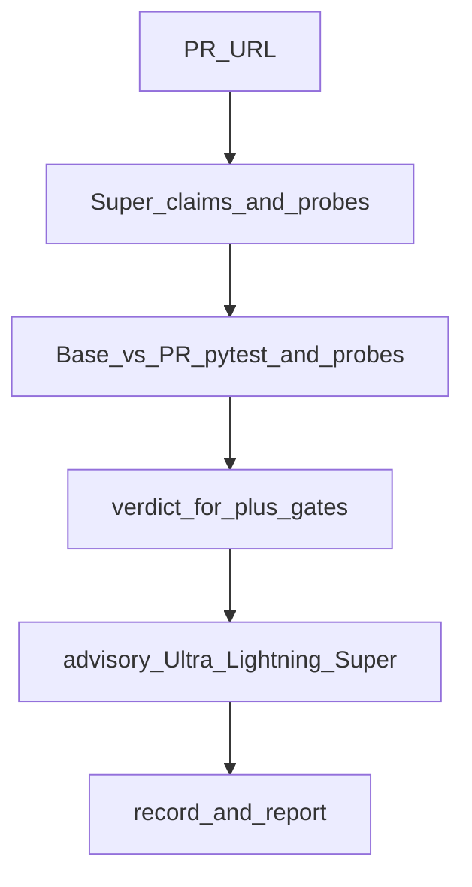
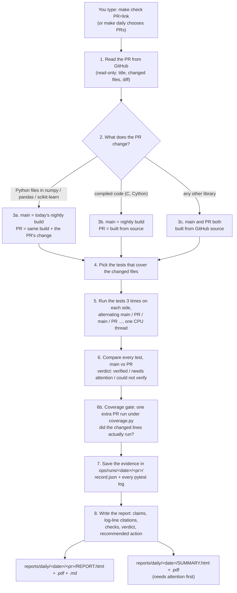

This project is [MIT licensed](LICENSE).

# Proof-of-Change

**Don't just read a pull request. Run it.**

Proof-of-Change takes a proposed change to an open-source Python library (a *pull request*, or "PR") and runs the
library's own tests twice: once without the change and once with it, three times each. It compares the results test by
test and writes a short report for a person to read, with a verdict (VERIFIED, NEEDS ATTENTION or COULD NOT VERIFY),
a recommended action, and a link to the exact log line behind every statement. It only gives advice: it never
blocks anyone's change. On **demo/mirror repos you allowlist**, it can also reply on GitHub with a check and a
comment; it never posts to random upstream projects.

> New words are explained the first time they appear. There is also a [glossary](#glossary) at the end.

## Current limitations

- Big applications with huge dependency lists (for example home-assistant, erpnext, or vllm-scale projects) usually end as COULD NOT VERIFY. Setup installs too much, and anything that needs a C or system build fails in Contree, because pull-request checks never install operating-system packages.
- For apps built from many components, each listing its own requirements (like home-assistant integrations), a PR check installs only the touched component's packages plus the core requirements, read from main, and never the combined list of every component. This chooses the right packages; it is not confirmed that such a check finishes, and no such check has reached verified. If the changed files don't fall inside a single component (for example, changes to home-assistant's core files), the check ends as COULD NOT VERIFY. Confirmed on a real check: home-assistant #187420 scoped to the one integration, then setup failed building a core package that needs a C++ compiler.
- Big applications whose own core requirements need a C or C++ build, with no ready-made packages (wheels) for the Python version the project requires, end as COULD NOT VERIFY. For example, home-assistant requires Python 3.14, and two of its core packages, pymicro-vad and pyspeex-noise (home-assistant requirements.txt lines 45 and 48), have no ready-made packages for 3.14 and need a C++ compiler, which the sandbox does not have. PR checks never install operating-system packages such as compilers, and they never switch to a Python version the project does not allow.
- Docs-only pull requests are skipped in the daily run. A single check in full mode ends as COULD NOT VERIFY because the AI-probe gate needs a probe that runs a changed line. Other modes can still mark a docstring-only change VERIFIED, with the reason 'holds by construction'.
- Contree is confirmed end-to-end only for a real product check (apprise pull request #1783, confirmed on commit cecf851) run from main in Contree-only mode (`POC_REQUIRE_CONTREE=1`), where the verdict matched the local run and nothing ran outside Contree. Not confirmed on the live Contree service: test coverage measured inside Contree, which shell runs setup, hiding of failure text, and running with a judge's own Nebius account.
- Projects that need their own package index or uv sources, or that run on a pre-release (test) build of Python, end as COULD NOT VERIFY by design. Main and the pull request must run the exact same Python version, or the result is COULD NOT VERIFY.

## What we can and can't test

A longer version of this section is in [docs/LIMITATIONS.md](docs/LIMITATIONS.md#what-we-can-and-cant-test).

Proof-of-Change checks Python projects. A project in another language is not supported. The tested set is these 19 small Python libraries: pytest, requests, rich, attrs, click, isort, jsonschema, boltons, python-barcode, httpx, urllib3, python-qrcode, itsdangerous, markupsafe, prettytable, loguru, sqlparse, toolz and invoke.

A project that needs compiling is not supported. That includes code written in C, C++ or Rust. The daily run enforces this for dependencies before it selects pull requests. It resolves the project's runtime requirements and allows only ready-built packages, so that step compiles nothing and installs nothing. If a requirement has no ready-built package, that project's pull requests are left out of the run. The check reads the dependencies in the project file and the plain lines of a top-level requirements file. It does not open the project's own compiled code, and it does not read optional or test requirements, so a project can still reach setup and fail there. A check of one named pull request does not run this test. When a check needs a compiler, the check does not install one. Setup fails, and the result is could not verify.

In a Contree run, each probe is measured on the main side inside Contree. If that measurement fails for any reason, the probe is left unmeasured and cannot count toward verified.

Line coverage of a probe is measured only on the main side, in main's line numbers. A line the pull request adds is judged by the main lines next to it, so a check can pass without ever running a newly added branch of the code. A pull request that only adds new files cannot be verified.

A probe counts as measured when only some of the changed files show up in its coverage.

The AI writes the claims and the checks fresh on every run. The same pull request on the same code can get a different verdict on another run. An earlier run of one pull request came out needs attention, and a later run came out verified.

Tests and probes in the local sandbox have no internet. The network is on only while packages are installed. Secret keys are not given to that sandbox, and they are not placed in a Contree shell. A behaviour that needs a network service, a password or a key cannot be tested.

Verified means the behaviour the change described still holds. Needs attention means the check found a difference a person should look at. Could not verify means the check cannot say whether the change is fine. Passing probes never raise the verdict. The tool never approves a pull request and never merges one. A person decides.

Not built: the same-commit guard on a study run. A product check stops when main and the pull request are the same commit. A study run does not apply that guard.

Built, and not confirmed on the live Contree service: measuring test coverage inside Contree, which shell runs setup, hiding of failure text, and running with a person's own Nebius account.

Of 12 pull requests from the tested libraries, 0 were verified, 4 need attention (isort, jsonschema, rich, prettytable) and 8 could not be verified (requests, attrs, click, urllib3, sqlparse, toolz, markupsafe, boltons). In every record, main differed from the pull request. The missing probe measurement above is what keeps any of them from verified. The probes crashed on main for requests, sqlparse, toolz and attrs. For attrs, the new tests passed, but the check written for the pull request's claim crashed on main, so the claim itself was never tested. markupsafe had a setup failure. click, urllib3 and boltons had no probe that ran a changed line.

## For hackathon judges (quick answers)

| Question | Answer |
|---|---|
| **Problem?** | Green CI tests can miss behavioral drift. Proof-of-Change dual-runs base vs PR and compares evidence. |
| **What is different?** | Models may write claims/probes and explanations, but **plain code owns the verdict**. |
| **What does the swarm do?** | After the code verdict: **Ultra** labels findings, **Lightning** suggests noise/install notes, **Super** writes a quote-checked summary. Those three roles are **advisory**. **Super** also extracts claims and writes probes earlier (that path *can* affect the verdict via executed probe diffs). |
| **NVIDIA Nemotron?** | Super / Ultra / Lightning (Nano fallback) via configured model IDs in `poc/model_provider.py`. |
| **Nebius at runtime?** | OpenAI-compatible chat completions at `https://api.tokenfactory.nebius.com/v1` using `NEBIUS_API_KEY` in the orchestrator only. Optional Contree sandboxes need the project ID as `NEBIUS_PROJECT_ID` for command-line and daily runs; a console check uses only the key and project ID typed into its start form. |
| **Try it?** | Judges: see [For judges](#for-judges). The results page replays finished checks in the browser. A request issue can run a new check. A Codespace can try one, but live checks there are not confirmed yet. Live checks need Linux. |
| **Reproduce evaluation?** | See [`reports/AGENT_SWARM_EVALUATION.md`](reports/AGENT_SWARM_EVALUATION.md). Quick gate: `make test` (or `python -m evals.run_evals --observations evals/fixtures/golden_v1.jsonl --require-golden --require-v1`). |
| **Demo video** | _TODO: public YouTube ≤3 min_ — script in [`reports/DEMO_SCRIPT_3MIN.md`](reports/DEMO_SCRIPT_3MIN.md). |



## For judges

Judging runs 1–15 December. These three paths are free to use. Live checks need **Linux**. A Codespace is Linux. The results page is only a replay and works in a browser.

[](https://codespaces.new/aritracodesbad123/Proof-of-change?quickstart=1)

### Results page

<https://aritracodesbad123.github.io/Proof-of-change/>

This is the main link. It is the operator console in replay mode: light page, the flow chart, and the report for each finished check. It shows only the 30-PR random batch on code version 0fa0016; older runs are kept in `benchmarks/replay-archive/`. The page does not install a library and does not call an API. GitHub Pages is turned on in the repository settings (source: GitHub Actions), and the `pages` workflow publishes the page on every push to `main`.

### Request a check

1. Open a [Request a check](https://github.com/aritracodesbad123/Proof-of-change/issues/new?template=request-a-check.yml) issue.
2. Paste one public GitHub pull request link. Python libraries only.
3. Wait for a comment with the verdict and a report link. GitHub emails you.

Do not paste an email address, a key, or any private information into the issue. The issue is public.

The checker on the project machine takes one request at a time. It does not start between 10:40 and 12:30 IST. It stops after five checks per day unless that limit is changed on the machine. Each of those checks runs with the advisory swarm on. A study run and a benchmark run still leave that swarm off unless the run asks. The worker reads `TAVILY_API_KEY` from that machine. When the variable is missing it logs that the lookup was skipped and still runs the check. The key value is never printed. If a study run has the machine, your request stays in the queue. If the checker has not checked in recently, a short reply says it is offline and points back at the results page. The repository needs the labels `request-a-check`, `request-running`, and `request-done` (create them once under Issues → Labels). `request-running` is on the issue while a check is in progress.

### Try it yourself in a Codespace

Live checks in a Codespace have not been confirmed to work yet. For a result you can rely on, use the results page or [Request a check](#request-a-check). The steps below are for trying it anyway.

A Codespace usually cannot start bubblewrap, the local safety sandbox. A live check there therefore runs in Contree sandboxes, and that needs your own Nebius API key and Contree project ID. The design bills a Contree run to the Nebius account whose key you type. Running with a judge's own Nebius account is not confirmed on the live Contree service. Type them into the console's start form, where they stay in this tab's session storage and the server's memory for that session. A console check uses only the values typed into the form: it never uses `NEBIUS_API_KEY` or a project ID from the server's environment or Codespaces secrets. This project does not ship a key. The keys are used only for the check's own Contree and model calls and are never passed to pull-request code. With Contree, the design is that installs, tests and behaviour probes all run inside Contree. A product check is designed to measure test coverage inside Contree; this is not confirmed on the live Contree service. If that coverage file is missing, the result stays could not verify. A full check still needs an AI probe that ran a changed line. Contree-only mode does not measure probe coverage, so that full check stays could not verify. If neither sandbox can start, the console refuses to run pull-request code and says which keys to add.

1. Click the badge above, or use Code → Codespaces → Create.
2. Wait until setup finishes and the terminal says the console is listening on port 8787 (setup log: `/tmp/poc-setup.log`, console log: `/tmp/poc-console.log`). If the page on port 8787 does not load, run `bash .devcontainer/start-console.sh` in the terminal. Open the forwarded port **8787**. Do not make port 8787 public. It stays private. If that port is public, the console does not start and tells you to set it back to private. Sign-in is not skipped while the port is public.
3. Fill in the one start form. This Codespace does not ask you to sign in: it is your own machine, and email, Google, and GitHub sign-in are not set up here. Any other host still requires sign-in. The form has:
   - **Pull request URL** (required).
   - **Nebius API key** (required for a live check). Without it the check is refused with "Add your Nebius API key to run a live check."; only the saved sample button runs without a key.
   - **Nebius project ID** (optional, the Contree project ID). With your key, the design runs the check in Contree sandboxes and bills that account. Running with a judge's own Nebius account is not confirmed on the live Contree service.
   - **Tavily API key** (optional). The setup lookup needs it; without it the lookup is skipped. Tavily keys are free ([sign up](https://app.tavily.com/)). Codespaces also asks for it as the recommended secret `TAVILY_API_KEY`. Tavily can suggest package names, but one is installed only if its PyPI page links back to the same repo.
   - **Review the AI's probes** (ticked by default).
4. Click **Run check** once. Everything is sent together; there are no separate save buttons. Keys you typed are kept only in this browser tab's session storage, so they survive a page refresh and clear when the tab closes. They are never put in local storage or cookies. On the server they stay in memory for the session and are never written to disk, logs, reports, or the reply, and pull-request code never sees them. Leave a field blank to keep the value already sent this session.
5. If the check cannot start, the reason appears in plain words right above the button, for example "No sandbox available: add your Nebius project ID", or, when both are set but Contree cannot start, a message saying so without asking for them again.
6. A console check pauses for **Human review** by default: the AI drafts behaviour probes, you keep or drop each one and add your own test ideas, then the tests run. Untick the review option to skip it for one check. Study, benchmark, command-line, GitHub App and request-a-check runs never pause. The console that starts with the Codespace turns the advisory swarm on for a check you run there. A study run still leaves that swarm off unless you ask.

If bubblewrap cannot start and Contree is not set up, the console refuses to run pull-request code. It does not fall back on its own. If Contree fails to prepare the check and bubblewrap cannot start, the check also stops. The only opt-in is `POC_UNSAFE_NO_SANDBOX=1`, and the page shows a warning. The vetted prerecorded sample still plays back, and that playback does not run pull-request code.

**Untrusted code:** PR installs and tests run under bubblewrap when available (no orchestrator secrets in the sandbox env). The operator console refuses to run pull-request code when bubblewrap cannot start and Contree is not usable. The only opt-in is `POC_UNSAFE_NO_SANDBOX=1`, and the console shows a warning when that is set. Do not treat a prompt as a sandbox.

**Hackathon delta (this prep):** judge console sample + live/fixture badges + sandbox honesty; audit/eval/demo/checklist under `reports/`; README judge path. No invented accuracy claims; live Token Factory metrics require your API key.

## Built with NVIDIA Nemotron on Nebius Token Factory

Proof-of-Change uses **Nebius Token Factory** for models and optional remote sandboxes, and can also reply on
**your demo GitHub repos**:

1. **NVIDIA Nemotron models** that help read the pull request and explain the report.
2. **Optional Nebius sandboxes** — private cloud boxes that run untrusted PR code away from your computer
   (your Mac can still run checks locally if you prefer, or if remote sandboxes are not set up).
3. **Optional GitHub replies on demo repos** — comment `/prove` (or open a PR) on an allowlisted demo/mirror repo;
   Proof-of-Change runs the check and posts an advice-only check plus a short comment with a link to a
   *behavior-map* report. It does not post on repos outside that list.

Several Nemotron models share the work (exact model names are in [Technical details](#8-technical-details)):

| Model | What it does |
|---|---|
| **Super** | Reads the PR, lists what it claims, and writes small check scripts (*probes*). Also writes a short plain-English report summary that may only quote real lines from the run. |
| **Ultra** | Suggests a label for each finding (proven, false, not mentioned, or needs a person) with one sentence. **Advice only** — it does not change the verdict. |
| **Lightning** (with a smaller **Nano** backup) | Suggests install tips or “ignore this noise” notes. **Advice only.** |

Plain code then runs the project's real tests, and those probes, on both *main* (today's code) and the PR — either on
your machine or in a Nebius sandbox. **Comparing those runs is what decides the verdict.** The AI may explain and
suggest labels; it never decides pass or fail.

Tavily can suggest package names, but they're only installed if their PyPI page links back to the same repo. That check stops accidents, not a determined attacker.

## Scoring

Current results: the 30-PR random batch on code version 0fa0016. Full table, records and reports: [benchmarks/batch30-0fa0016](benchmarks/batch30-0fa0016/README.md). Older runs, including the earlier release comparisons: [benchmarks/replay-archive](benchmarks/replay-archive/README.md).

30 merged pull requests from public Python projects, drawn at random with a fixed seed (20261022; list in `benchmarks/batch30-0fa0016/drawn.json`). Every check ran on Proof-of-Change at commit `0fa0016`, finishing on 22 Oct 2026 at 11:03 IST. All 30 runs completed; none crashed. Verdicts are the ones in each run's own `record.json`.

### Verdicts

| Verdict | Count |
|---|---|
| Verified | 0 |
| Needs attention | 8 |
| Could not verify | 22 |

The trust check in the report flags [oyvindwe/connectlife-ha #742](benchmarks/batch30-0fa0016/runs/connectlife-ha-742/REPORT.md), [doobidoo/mcp-memory-service #1531](benchmarks/batch30-0fa0016/runs/mcp-memory-service-1531/REPORT.md) as untrustworthy (the run failed its own checks), so treat those two needs-attention verdicts with caution.

### Why: breakdown of reasons

| Reason | Runs |
|---|---|
| Setup failure: install failed | 12 |
| Difference found between main and PR | 8 |
| Changed code not exercised (incl. docstring-only) | 4 |
| Setup failure: setup gap | 3 |
| Tests did not run or collect | 3 |

Setup failures (install failed or setup gap) total 15 of 30. This is the biggest weakness the batch shows.

### Timing

From each record's `duration_s.total_wall`. Median run: 2 min 39 s. Fastest: pyrevitlabs/pyRevit #3743 (14 s). Slowest: macs3-project/MACS #784 (341 min 45 s), optiland/optiland #963 (69 min 57 s), optuna/optuna #6873 (69 min 56 s). The MACS #784 run is the outlier.

### Accuracy: not measured for this batch

Catches, misses and false alarms count only where there is outside proof of the right answer: a later revert, a follow-up bug report blaming the PR, or a maintainer's explicit confirmation. Passing maintainer CI or closing a linked issue is not proof. We searched GitHub for reverts and follow-up fixes for all 30 PRs and found none, so **all 30 PRs are unlabelled** (`benchmarks/batch30-0fa0016/labels.json`) and no accuracy, false-alarm or miss rate is reported. No labels were invented.

---

**Contents:** [Current limitations](#current-limitations) · [What we can and can't test](#what-we-can-and-cant-test) · [Scoring](#scoring) · [Setup](#1-one-time-setup-on-a-mac) · [Check one PR](#2-check-one-pr) ·
[Operator console](#2b-operator-console-browse--start-checks) ·
[How a report is made](#3-exactly-how-a-report-gets-generated) ·
[Read a report](#4-how-to-read-a-report) · [Where files live](#5-where-files-live) ·
[Troubleshooting](#6-troubleshooting) · [What it never does](#7-what-it-never-does) · [Technical docs](#8-technical-details)

---

## 1. One-time setup on a Mac

You do this once. It takes about 10 minutes. You will type commands into **Terminal**, the Mac's text window for
commands.

**Open Terminal:** press `⌘ Command` + `Space`, type `Terminal`, press `Return`. A window with a blinking cursor opens.
In this guide, grey text like this is something to type. Type it (or copy and paste it) and press `Return`.

### Step 1: Install the Mac developer tools (git and make)

*git* downloads code; *make* runs the short commands this project uses.

```bash
xcode-select --install
```

- **What you should see:** a pop-up asking to install "command line developer tools". Click **Install** and wait
  until it says it is done (5 to 10 minutes).
- **If it says** `command line tools are already installed`: good, nothing to do. Go to step 2.

### Step 2: Install Python 3.12

*Python* is the programming language Proof-of-Change is written in. You need version 3.11 or newer.

1. Open <https://www.python.org/downloads/macos/> in your web browser.
2. Download the latest **Python 3.12** "macOS 64-bit universal2 installer" and open it. Click through the
   installer (Continue, Agree, Install).
3. Back in Terminal, check it worked:

```bash
python3 --version
```

- **What you should see:** `Python 3.12.something` (3.11 or 3.13 are fine too).
- **If you see** `Python 3.9.6` (the old version that comes with the Mac): close Terminal completely (`⌘ Q`), open it
  again and retry. If it still says 3.9, use `python3.12` instead of `python3` in step 4:
  `make setup PYTHON=python3.12`.

### Step 3: Download Proof-of-Change

This makes a folder called `Proof-of-change` in your home folder and moves into it.

```bash
cd ~
git clone https://github.com/aritracodesbad123/Proof-of-change.git
cd Proof-of-change
```

- **What you should see:** `Cloning into 'Proof-of-change'...`, possibly a few progress lines, and then the prompt
  comes back with no error.
- **If it says** `destination path 'Proof-of-change' already exists`: you downloaded it before. Just run
  `cd ~/Proof-of-change` and then `git pull` to get the newest version.

Check that the download is complete:

```bash
ls Makefile
```

- **What you should see:** `Makefile`.
- **If you see** `No such file or directory`: the newest version hasn't reached the `main` branch yet. Type
  `git switch feat/integrate-golden`. You should see `Switched to a new branch 'feat/integrate-golden'` (and a line
  saying it is set up to track `origin/feat/integrate-golden`).

### Step 4: Install Proof-of-Change

This creates a private Python environment (a *venv*, a folder called `.venv` that keeps this project's add-ons away
from the rest of your Mac) and installs everything into it.

```bash
make setup
```

- **What you should see** (after about a minute), as the last line:
  `SETUP OK: Proof-of-Change is installed. Next: make check PR=<pull request link>`
- **If you see** `Python 3.9.6 is too old`: go back to step 2.
- Anything else: see [Troubleshooting](#6-troubleshooting).

### Step 5 (optional): Install Google Chrome for PDF reports

Reports are always made as web pages (HTML). If **Google Chrome** is installed in your Applications folder, a PDF copy
is made too. Get it from <https://www.google.com/chrome/> if you want PDFs.

### Step 6: Nebius API key (for normal checks)

A normal `make check` uses Nebius for the Nemotron models. You need an API key from the
[Nebius Token Factory](https://tokenfactory.nebius.com/) console.

In Terminal (same session where you will run the check):

```bash
export NEBIUS_API_KEY="paste-your-key-here"
```

- Do not put the key in a chat, a screenshot, or a commit.
- **What you should see:** nothing (setting a variable is silent). Check it is set with
  `test -n "$NEBIUS_API_KEY" && echo ok` — you should see `ok`.
- **If the key is missing**, the run stops at once with a short message that names `NEBIUS_API_KEY`. That is on purpose.
- To run **without** AI on purpose (fixed probes only): see [Technical details](#8-technical-details) for
  `--model-provider none`.

### Step 7 (optional): Nebius sandboxes (run PR code in the cloud)

By default, untrusted PR code runs in a *sandbox* on your computer (a private place that cannot touch the rest of
your Mac). To run those checks in **Nebius sandboxes** instead:

1. In the Nebius Token Factory console, copy your **project id**.
2. In Terminal:

```bash
export NEBIUS_PROJECT_ID="paste-your-project-id-here"
.venv/bin/pip install -e ".[contree]"
```

3. Pass `--sandbox-backend contree` when you run a check (see [Technical details](#8-technical-details)).

- **If the project id is missing**, Proof-of-Change still works: it runs on your computer with the local sandbox, and
  the report says so.

### Step 8 (optional): GitHub replies on a demo repo

The usual path is still `make check` on your Mac. If you want Proof-of-Change to answer on GitHub itself:

1. Put only **your** demo or mirror repos in an allowlist (never a random upstream project):

```bash
export POC_DEMO_REPOS="your-org/your-demo-repo"
```

2. Install the GitHub App on that repo, set the webhook secret and an installation token (or App id + key — see
   [Technical details](#8-technical-details) / [OPERATIONS](docs/OPERATIONS.md)), and run:

```bash
.venv/bin/python -m poc.github_app
```

3. On a PR in that demo repo, comment `/prove` or `/prove "one claim in quotes"`.

- **What you should see:** an advice-only GitHub check (it never fails the check or blocks merge), a short comment
  with the verdict, and a behavior-map HTML report under `reports/hosted/` (linkable if you set a public report base
  URL).
- **Without App credentials**, the same code can dry-run: it plans the reply but does not post.

### Step 9 (optional): Self-check

```bash
make test
```

- **What you should see** at the end: `SELF-CHECK OK`. Before that, lines such as `All checks passed!`,
  `no external side effects found`, `... passed` and `"recommendation": "APPROVE"`.

**Every time you come back later:** open Terminal and type `cd ~/Proof-of-change` first. Re-export `NEBIUS_API_KEY`
(and `NEBIUS_PROJECT_ID` if you use Nebius sandboxes) in that Terminal session. Setup itself is never needed again.

---

## 2. Check one PR

1. Find the PR on GitHub and copy its link from the browser's address bar. It looks like
   `https://github.com/numpy/numpy/pull/32940`.
2. In Terminal (inside `~/Proof-of-change`), type `make check PR=` followed by the link:

```bash
make check PR=https://github.com/numpy/numpy/pull/32940
```

> **App-style repositories can be slow.** Some projects are applications rather than installable packages (for example
> PostHog). The check then sets up the Python version the project asks for and installs every dependency it declares,
> which can take much longer. A check of a PostHog pull request took about 22 minutes. Big applications with huge
> dependency lists usually end as COULD NOT VERIFY. See [Current limitations](#current-limitations).

- **What you should see** (the first time takes a few minutes because test environments are downloaded; later about
  1 to 4 minutes per PR):

```
[numpy/numpy] priority 1: selected [32940]
  testing #32940 BUG: fix nanquantile dtype for all-NaN first slice ...
    -> verified: 3 new test(s) pass, 1280 unchanged (48.5s)
...
DONE. Open this file to read the results:
  /Users/you/Proof-of-change/reports/daily/2026-10-10-check-0621/SUMMARY.html
```

3. Open the report:

```bash
make open
```

Your browser opens the summary page. Click **HTML** (or **PDF**) next to the PR to read its full report.

- **If it says** `not a GitHub pull request link`: the link must contain `/pull/` and a number. Copy it again from
  the PR's page.
- **If the verdict is COULD NOT VERIFY:** there is no conclusion about the PR, and the report's "What went wrong and
  how to fix it" section says why. Usually the check itself failed (for example, the change needs a C compiler).
  It also happens when the PR's new or changed tests were skipped because an optional module (such as `scipy`) is not
  installed, or when the reason starts with **"not fully verified"**: the tests ran fine, but they never ran the
  code the PR changed (see "Was the changed code exercised?" in section 4). None of these is a judgement of the PR.

### 2b. Operator console (browse + start checks)

Web console (NVIDIA-themed React UI + local API): paste a GitHub PR link, watch the **pipeline stages** and the **Nemotron swarm** (Ultra · Lightning · Super) light up for that PR, then open the verdict and behavior map.

**No API key?** Use **Try sample (mlxtend#1229, prerecorded)** — the UI labels it as a fixture (not blind). Live Nebius runs show a separate **Live Nebius / Nemotron** badge. If the host has no sandbox, the console refuses to run pull-request code. On any such host, that same vetted sample still plays back, and the playback does not run pull-request code. Setting `POC_UNSAFE_NO_SANDBOX=1` is the only way to run unsandboxed, and that choice appears as a warning banner from `/api/health`.

```bash
make console-api    # terminal 1 — http://127.0.0.1:8787
make console-web    # terminal 2 — http://127.0.0.1:5173
```

Open **http://127.0.0.1:5173**. The page is light. Sign in before the run list loads. Needs Node.js for the UI (`npm` under `console/web/`). Or build once and serve UI from the API:

Email sign-in needs `SMTP_HOST`, `SMTP_PORT`, `SMTP_USER`, `SMTP_PASSWORD`, and `SMTP_FROM` (the older `POC_SMTP_*` names still work). Google uses `GOOGLE_CLIENT_ID` and `GOOGLE_CLIENT_SECRET`. GitHub sign-in uses `GITHUB_OAUTH_CLIENT_ID` and `GITHUB_OAUTH_CLIENT_SECRET` (not `GITHUB_TOKEN`). Set `SECRET_KEY` to a long random string so the session cookie is signed. `POC_ADMIN_EMAIL` names the one admin. `POC_SIGNUP_DISABLED=1` stops new accounts. `POC_INVITE_CODE`, when set, is required to create an account. Do not set `POC_OTP_TEST_SINK` on a host. Accounts are a file on disk (`POC_ACCOUNTS_FILE`); a free host wipes that file on restart.

A free [Hugging Face Space](docs/deploy/huggingface.md) (Docker, port 7860, 2 CPU cores and 16 GB of RAM) is the place to run the sample when Render’s 512 MB restarts mid-test. If that Space cannot start bubblewrap, only the prerecorded sample plays back, and it does not run pull-request code.

```bash
make console-build && make console-api
# then open http://127.0.0.1:8787
```

**Public website without paying Nebius Compute:** use **Render free** (Blueprint = [`render.yaml`](render.yaml)) or a local tunnel — details in [docs/OPERATIONS.md](docs/OPERATIONS.md) (Free public URL). Keep `NEBIUS_API_KEY` for models only.

**Nebius Endpoint** (only if you have AI Cloud credits): `make docker-console` + `make nebius-console`. Local bind: `make console-host`.

`make check` still works the same; the console calls that same path.

The default libraries are **numpy, pandas and scikit-learn**. Other libraries are downloaded and built from their
source code, which takes longer. A check can end as COULD NOT VERIFY for the reasons in
[Current limitations](#current-limitations).

### Check every tracked library at once

```bash
make daily
```

This runs the same check against a list of tracked libraries, `ops/tracked-libraries.csv` (numpy, pandas and
scikit-learn to start with; add a row to track another library). For each library it takes up to 3 open PRs that
changed since the last run and tests each one as above. It takes about **15 to 20 minutes** and ends with the same
`DONE. Open this file...` line. The summary page lists the PRs that need a decision first.

If you run it again on the same day, the earlier attempt is not lost: it moves to
`ops/runs/<date>/superseded/attempt-N/`, and the new attempt re-tests every PR any earlier attempt picked. The
summary page lists the attempts under **Re-runs**.

---

## 3. Exactly how a report gets generated

From a PR link to the HTML/PDF in `reports/`, in order:



1. **Read the PR.** Proof-of-Change downloads the PR's title, the list of changed files and the change itself
   (the *diff*) from GitHub. It only reads; it never writes to GitHub.
2. **Decide how to build the two sides.** *main* is the library as it is today, and *PR* is the library with the
   change. Step 3 is chosen automatically from the files the PR touches.
3. **Build both sides.** It saves a clean copy of *main*, then a copy for the *PR* (with the change applied). That
   happens in a throw-away folder under `ops/work/` on your Mac, or in a Nebius sandbox if you asked for one.
4. **Pick tests.** It uses the test files that belong to the changed code, for example `test_rolling.py` for
   `rolling.py`.
   The test extras and the optional modules the tests use (for example `scipy` and `pyarrow` for pandas) are
   installed on both sides, so tests aren't skipped for a missing module.
5. **Run claim probes and the project's tests** on both sides (tests: 3 times per side, alternating, one CPU thread)
   so a test that fails only now and then (*flaky*) is caught and not mistaken for a real change.
6. **Compare.** Each test's result on main is compared with its result on the PR. Rules written as plain code (not AI)
   decide the verdict. A test whose parameters were renamed by the PR (for example `test_min_count[first--1-1.0]`
   became `test_min_count[first-0-1.0]`) is recognised as **re-parametrized**, not reported as a missing test. If the
   PR's new or changed tests were skipped because an optional module is missing, the verdict is COULD NOT VERIFY,
   never VERIFIED: the change was not tested.
   **6b. Coverage gate.** The PR side's tests run once more, untimed, under coverage.py, to measure how many of the
   PR's changed code lines actually ran. On a Contree-only product check the design runs that extra coverage pass
   inside Contree and reads the report back. Measuring test coverage inside Contree is not confirmed on the live
   Contree service. VERIFIED only stays VERIFIED if the changed code was exercised (section 4). A product check
   whose coverage file is missing stays COULD NOT VERIFY.
7. **Save the evidence:** `record.json` (what was done and found) and every raw test log.
8. **Write the report.** For each PR it builds the claims table, finds the exact log line behind every claim, re-reads
   each line to make sure it is really there, runs its own safety checks, and chooses the verdict, recommended action
   and confidence. The report may also include a short **AI summary** and suggested labels — helpful extras, not the
   decision. Then it writes the HTML, the PDF (if Chrome is installed) and a Markdown copy, plus one summary page for
   the whole run.

---

## 4. How to read a report

Open `SUMMARY.html` first. It lists every PR, with the ones that need a decision at the top. Click **HTML** or **PDF**
to open one PR's report. Each report reads top to bottom:

**The verdict banner** (the coloured panel at the top):

| Verdict | Colour | Means |
|---|---|---|
| **VERIFIED** | green | The tests behave the same or better with the change. |
| **NEEDS ATTENTION** | amber | The check worked and found a difference a person should look at. |
| **COULD NOT VERIFY** | grey | No conclusion about the PR: the check itself didn't finish properly, or (reason starting "not fully verified") the tests passed but never ran the changed code. |

**Recommended action** (the small badge in the banner):

| Action | What to do |
|---|---|
| **Approve** | Nothing found. You can approve. |
| **Approve with notes** | Fine, but read the notes under "What went wrong" first (for example a flaky test). |
| **Reject** | Don't approve as is. Something changed that the PR doesn't explain. |
| **Re-run** | Don't decide yet. Fix the problem described in the report and run the check again. |
| **Review by hand** | The tests didn't exercise the change (coverage gate). Read the change yourself, or ask the author for a test that runs it. Running the check again won't help. |

**Known-answer tests can override everything.** Three cases where the right answer is already known (the golden
cases in `evals/golden_cases.json`) are re-run regularly, and the latest result is kept in a status file (see
`BR_GOLDEN_STATUS` in [docs/OPERATIONS.md](docs/OPERATIONS.md)). If the latest re-run failed, **every report says
COULD NOT VERIFY / Re-run, with Low confidence**, whatever it found. The reason starts with "Forced: the known-answer
tests failed on ...". A tool that gets known answers wrong can't be trusted on new ones. Once the known-answer tests
pass again, run the check again (or regenerate the report) to get a real verdict. The "Known-answer replay" line
under the report's checks shows the latest result.

**Was the changed code exercised? (the coverage gate).** Passing tests only mean something if they ran the code the
PR changed. So each check runs the PR side's tests one extra time under coverage.py and counts the PR's changed,
executable lines (in the library itself, not in its tests) that ran:

| What the PR changed | Result | What the report says |
|---|---|---|
| Python code, **none** of the changed lines ran | VERIFIED becomes **COULD NOT VERIFY / Review by hand** | "not fully verified: changed code never ran: 0 of 12 changed executable line(s) ran (0%)" |
| Python code, **under half** of the changed lines ran | verdict unchanged, confidence lowered to Medium | "3 of 10 changed executable line(s) ran (30%)" |
| Python code, half or more ran | verdict unchanged | "8 of 10 changed executable line(s) ran (80%)" |
| **Compiled code** (C, C++, Cython), and the PR adds or changes **no test for that module** | VERIFIED becomes **COULD NOT VERIFY / Review by hand** | "not fully verified: compiled code changed (...)" |
| Compiled code, and the PR adds or changes a test for that module (for example `test_item_selection.py` for `item_selection.c`) | verdict unchanged | the note names the compiled file |
| Only docs, tests or settings (no executable code) | stays VERIFIED | "no executable code changed" |

The gate never turns NEEDS ATTENTION into anything else. The numbers are in the report section **"Was the changed code
exercised?"**, with one line per changed file, and in `record.json` as `changed_lines_covered` / `changed_lines_total`.
Its limits: coverage.py can't see inside compiled code, so for C/C++/Cython the gate only checks that the PR brings
a test for the changed module (by file name), not that the test reaches the changed lines. Reports rebuilt from
records written before 10 Oct 2026 say "coverage ... was not measured" with Medium confidence; compiled changes in
those records are still judged by the compiled-code rule. Example: numpy#32910 (C change in `item_selection.c`, no
test added) was VERIFIED on day 1 and is now COULD NOT VERIFY / Review by hand.

**Confidence:** *High* means every safety check passed. *Medium* means some warnings, listed in the report (for
example under half of the changed lines ran, or coverage was not measured). *Low* means there is no conclusion.

**The sections, in order:**

| Section | What it tells you |
|---|---|
| Summary in plain English | Three lines: what the PR says it does, what we saw, what you should do. May be followed by an AI summary (advice only) that quotes real lines from the run. |
| Claims vs reality | Each claim, whether it held up (*proven*, *false*, *not testable*, or an *unmentioned change*), and the **log line** that proves it. Click the log line to see the raw evidence. |
| What changed in behavior | Counts of tests that stayed the same, newly pass, newly fail, went missing, were flaky, were re-parametrized (renamed cases), were skipped for a missing optional module, or already fail on main, with examples. |
| Was the changed code exercised? | The coverage gate: how many of the PR's changed lines ran, per file, and whether that changed the verdict. |
| Missing optional modules | Only shown when tests were skipped because a module like `scipy` isn't installed. |
| What went right | The checks that passed. |
| What went wrong and how to fix it | Each problem, with the fix next to it. |
| Evals and guardrails | The safety checks on the run itself: 3 runs per side, one thread, nothing posted to GitHub, every citation real. |
| Checklist | Four things to tick before deciding. |
| Rerun command | The exact command to run this check again. |
| Evidence links | The PR, its diff, and every log and data file. |
| Glossary | The words used in the report. |

**To approve or reject:** there's no button. Proof-of-Change doesn't touch GitHub. You record your decision with one
command, and the report then shows "Decision recorded: ... by you". The report's Checklist section shows the exact
command for that PR. For example:

```bash
make decide REPORT=reports/daily/2026-10-10-check-0621/numpy-32940 DECISION=approve
make decide REPORT=reports/daily/2026-10-10-check-0621/numpy-32940 DECISION=reject NOTE="breaks rounding"
```

`DECISION` can be `approve`, `approve_with_notes`, `reject` or `re_run`. The folder is the one that contains that PR's
`REPORT.html`. If you want to tell the PR's authors, you do that yourself on GitHub. Proof-of-Change never does it
for you.

---

## 5. Where files live

Everything is inside the `Proof-of-change` folder (on your Mac: `~/Proof-of-change`).

| Where | What |
|---|---|
| `reports/daily/<date>/SUMMARY.html` | **Start here.** One page per run, needs-attention first. Also `.pdf` and `.md`. |
| `reports/daily/<date>/<pr>/REPORT.html` | The full report for one PR (also `.pdf`, `.md`). `DECISION.json` holds your decision. |
| `ops/runs/<date>/<pr>/` | The raw evidence: `record.json`, `pytest-main-1.log` ... `pytest-pr-3.log`, the diff, setup logs. |
| `ops/runs/<date>/REPORT.md` | The run's technical log (what was picked, skipped, how long it took). |
| `ops/tracked-libraries.csv` | The list of tracked libraries for `make daily`. |
| `reports/samples/golden-v1/` | Example reports for three known cases, kept in git. |
| `docs/` | Technical documents (see section 8). |

A check made with `make check` goes in a folder named like `2026-10-10-check-0621` (date, then the time). The daily
run uses just the date. These folders stay on your computer only. They are never uploaded.

---

## 6. Troubleshooting

| What you see | What it means | What to do |
|---|---|---|
| `xcode-select: error: command line tools are already installed` | Already done. | Go on to the next step. |
| `git: command not found` or `make: command not found` | The Mac developer tools are missing. | Run `xcode-select --install` (setup step 1). |
| `python3: command not found` | Python isn't installed. | Setup step 2. |
| `Python 3.9.6 is too old` | `python3` is still the Mac's built-in old Python. | Close and reopen Terminal, or use `make setup PYTHON=python3.12`. |
| `Not set up yet: run 'make setup' first.` | You're in the right folder, but setup hasn't run. | `make setup`. |
| `make: *** No rule to make target 'check'` or `No such file or directory` | You're not in the project folder. | `cd ~/Proof-of-change` and try again. |
| `Give the pull request link, e.g.: make check PR=...` | `PR=` was left out. | Add `PR=` and the link, with no spaces around `=`. |
| `not a GitHub pull request link` | The link isn't a PR link. | Copy the link from the PR page; it must contain `/pull/<number>`. |
| `GitHub rate limit hit` | GitHub allows 60 anonymous reads per hour (worse on shared Render IPs). | Set a read-only `GITHUB_TOKEN` on the host (Render secret / local env), then redeploy or restart. See docs/OPERATIONS.md. |
| `Stopped: only N GB of free disk space` | Test environments need about 20 GB free. | Free up disk space and try again. |
| `note: no Chrome/Chromium found, so no PDFs` | Chrome isn't installed. HTML reports are still made. | Install Google Chrome (setup step 5) and run the check again. |
| Verdict **COULD NOT VERIFY**, reason `source build ... failed` | The PR changes C code and couldn't be compiled. | Normal for some PRs. The report says why. Try again in a day or two (a newer nightly build may help). |
| Verdict **COULD NOT VERIFY**, reason `not fully verified: changed code never ran` | The tests picked for the PR passed, but none of them ran the lines the PR changed. | Not a fault of the check or the PR. Read the change yourself, or ask the author for a test that covers it. |
| Verdict **COULD NOT VERIFY**, reason `not fully verified: compiled code changed` | The PR changes C/C++/Cython code and adds no test for it; coverage can't see compiled code. | Review the change by hand, or ask the author for a test of that module. |
| Verdict **COULD NOT VERIFY**, reason `... skipped or blocked because optional dependency ... not installed` | The PR's new tests need a module that isn't installed. | Add the module to that library's `optional_test_deps` in `ops/daily_run.py` and run the check again. |
| Verdict **COULD NOT VERIFY**, reason `patch does not apply` | The PR is based on older code than today's nightly build. | Nothing to fix on your side. Try again later. |
| Every report says COULD NOT VERIFY, reason "Forced: the known-answer tests failed on ..." | The latest known-answer re-run failed, so no verdict is trusted (section 4). | Fix what made the known-answer re-run fail. Once it passes again, run `make check` again. |
| `make open` prints a path but no browser opens | The browser didn't start. | In Finder, press `⌘ Shift G`, paste the printed path, and double-click the file. |
| The first `make check` is slow | It downloads test environments (several hundred MB). | Later checks are much faster. |
| `STOPPED: ... NEBIUS_API_KEY is not set` | The run needs a Nebius API key for the models. | Set `NEBIUS_API_KEY` (setup step 6), or pass `--model-provider none` if you mean to run without AI. |
| Report says it ran on `local` even though I asked for Nebius sandboxes | Project id missing, or the sandbox helper is not installed. | Set `NEBIUS_PROJECT_ID`, run `.venv/bin/pip install -e ".[contree]"`, and pass `--sandbox-backend contree`. |
| No GitHub comment or check after `/prove` | Repo not in the demo allowlist, webhook not running, or App credentials missing. | Set `POC_DEMO_REPOS`, run `python -m poc.github_app`, and set the installation token / webhook secret (see OPERATIONS). |
| Anything else | | Copy the last 20 lines from Terminal and open an issue on this repository with them. |

---

## 7. What it never does

- **Never posts to upstream or random repos.** Comments and check runs go only to demo/mirror repos you put in
  `POC_DEMO_REPOS`. Everywhere else it only *reads* public information. The CLI path (`make check`) never posts.
- **Never blocks a merge.** The GitHub check is advice only (`success` or `neutral` — never a failing check). Merging
  is always someone's own decision on GitHub.
- **Never gives your GitHub token to the code under test.** Tokens are used only by the orchestrator (read API, or
  App posts on demo repos) and are removed before any PR code runs.
- **Never uploads reports or logs** unless you host the static behavior-map HTML yourself (optional public base URL).
  Default reports stay in the folder on the computer that ran the check.
- **Never uses AI to decide the verdict.** Test comparison and verdicts are plain, testable code. AI may write a
  short summary and suggest labels; those are advice only.
- **Never lets a web page decide the verdict.** On a product check, a few related public bug reports may be
  passed to the advisory AI as quoted background. A study run does not look them up. They do not change the verdict
  and they do not choose a package.
- **Never sends your Nebius key or GitHub token into the sandbox where PR code runs.** Keys stay in the orchestrator
  process only.

---

## 8. Technical details

- [docs/OPERATIONS.md](docs/OPERATIONS.md): how PRs are selected and built, every flag, every file a run writes,
  including the baselines (`--baseline tests|tests+diff|tests+probes|full`), model-written probes
  (`--model-provider nebius|recorded|none`; key in `NEBIUS_API_KEY`), optional model ids
  (`--claims-model`, `--probe-model`, `--judge-model`, `--helper-model`, `--summary-model`), where untrusted code
  runs (`--sandbox-backend local|contree`; Nebius sandboxes also need `NEBIUS_PROJECT_ID` and
  `.venv/bin/pip install -e ".[contree]"`), the probe freeze rule, and the optional GitHub App
  (`POC_DEMO_REPOS`, webhook secret, installation token, `POC_REPORT_BASE_URL`, `python -m poc.github_app`).
  On a product check, `--related-reports` (passed by the operator console, request-a-check, and the GitHub App)
  looks up a few related public bug reports when `TAVILY_API_KEY` is set and the advisory swarm will run, and
  passes them to that AI as quoted background. The report labels the text
  "Background (related public bug reports, not used for the verdict)". A study run leaves this off. When the
  swarm is off, the lookup is not called. Without the key, the check logs one line and continues. The key is never printed.
- Model ids on Token Factory: `nvidia/nemotron-3-super-120b-a12b` (claims, probes, summary),
  `nvidia/Nemotron-3-Ultra-550b-a55b` (advisory labels), `nvidia/Nemotron-3_5-Lightning` with fallback
  `nvidia/NVIDIA-Nemotron-3-Nano-30B-A3B` (advisory tips).
- Example with Nebius sandboxes (after setup steps 6–7):

```bash
.venv/bin/python ops/daily_run.py --pr "https://github.com/rasbt/mlxtend/pull/1229" --sandbox-backend contree
```

- Example GitHub App webhook server (after setup step 8; demo repos only):

```bash
export POC_DEMO_REPOS="your-org/your-demo-repo"
export GITHUB_WEBHOOK_SECRET="…"
export GITHUB_APP_INSTALLATION_TOKEN="…"
.venv/bin/python -m poc.github_app --port 8080
```

- [docs/REPORT_SPEC.md](docs/REPORT_SPEC.md): the report format and verdict rules.
- [docs/DEVELOPER.md](docs/DEVELOPER.md): code layout, the self-check, the downstream-test harness and golden
  records, and the contribution workflow.
- [docs/REQUIREMENTS.md](docs/REQUIREMENTS.md): the full requirements and open questions.

All commands: type `make` on its own to list them.

---

## Glossary

| Word | Meaning |
|---|---|
| PR (pull request) | A proposed change to a project on GitHub, waiting for the project's maintainers to accept it. |
| main | The project as it is today, without the PR. |
| diff | The exact lines a PR adds and removes. |
| claim | One behaviour the PR says is true, taken from its title or description. |
| probe | A small script that records what the code does on main and on the PR (it prints observations; it does not assert). |
| test | A small program, written by the project, that checks one behavior and passes or fails. |
| pytest | The tool that runs Python tests and writes the logs we cite. |
| log line | One line of a test log. Every statement in a report points to one. |
| flaky | A test that sometimes passes and sometimes fails with nothing changed. It's never used as evidence. |
| sandbox | A private place that runs PR code so it cannot touch the rest of your computer. |
| Nebius sandbox | The same idea, but on Nebius's machines instead of yours. |
| `/prove` | A PR comment on a demo repo that asks Proof-of-Change to run and reply. |
| demo repo | A GitHub repo you own (or a mirror) listed in `POC_DEMO_REPOS`; the only place the App may post. |
| behavior map | An HTML page that shows claims, probes, and advisory labels for one PR check. |
| check run (advice only) | A GitHub check that reports the verdict but never fails or blocks merge. |
| nightly build | A version of a library built automatically every night from its newest code. |
| venv | A private folder of Python add-ons for one project (`.venv`). |
| Terminal | The Mac app where you type commands. |
