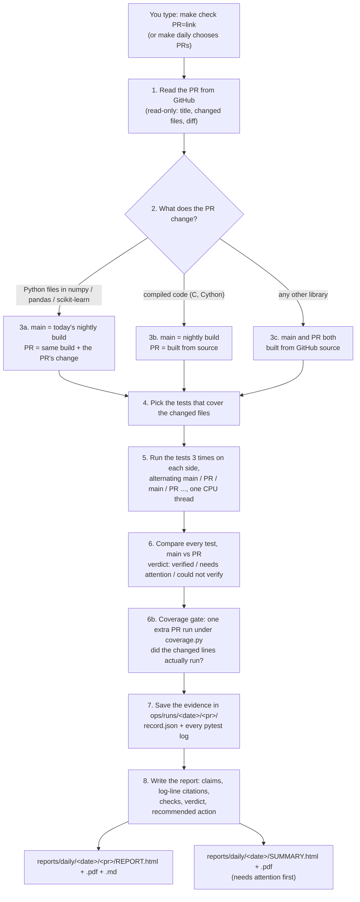

# Proof-of-Change

**Don't just read a pull request. Run it.**

Proof-of-Change takes a proposed change to an open-source Python library (a *pull request*, or "PR") and runs the
library's own tests twice: once without the change and once with it, three times each. It compares the results test by
test and writes a short report for a person to read, with a verdict (VERIFIED, NEEDS ATTENTION or COULD NOT VERIFY),
a recommended action, and a link to the exact log line behind every statement. It only gives advice: it never
comments on GitHub and never blocks anyone's change.

> New words are explained the first time they appear. There is also a [glossary](#glossary) at the end.

## Proven results

Each result below was reproduced 3 times on each side, with the same outcome every time. These are replays run after
the releases happened, to show the break was already visible at the release candidate. The records are in
`evals/fixtures/golden_v1.jsonl` and the reports in `reports/samples/golden-v1/`. The full raw logs are too large for
the repo; excerpts are in `evals/fixtures/runs/`.

**A real scikit-learn break, visible 24 days before the release**
scikit-learn 1.6.0rc1 (published 15 Nov 2024) no longer had a private helper, `_safe_tags`, that imbalanced-learn
0.12.4 imported. It was removed in [scikit-learn#29677](https://github.com/scikit-learn/scikit-learn/pull/29677).

| | scikit-learn 1.5.2 | scikit-learn 1.6.0rc1 |
|---|---|---|
| imbalanced-learn 0.12.4 tests | 2,238 passed | 0 passed, 525 errors (import fails: `_safe_tags`) |

Verdict: NEEDS ATTENTION. The final 1.6.0 came out on 9 Dec 2024, 24 days after the release candidate (it brought
`_safe_tags` back as a deprecated helper, [scikit-learn#30327](https://github.com/scikit-learn/scikit-learn/pull/30327)).

**A real pandas 3.0 break, visible 49 days before the release**
pandas 3.0.0rc0 (published 3 Dec 2025) makes Copy-on-Write the default
([pandas#56633](https://github.com/pandas-dev/pandas/pull/56633)), which breaks UpSetPlot 0.9.0 plotting
([UpSetPlot#303](https://github.com/jnothman/UpSetPlot/issues/303), opened 25 Jan 2026).

| | pandas 2.3.3 | pandas 3.0.0rc0 |
|---|---|---|
| UpSetPlot 0.9.0 tests | 233 passed, 6 failed | 166 passed, 73 failed |

Verdict: NEEDS ATTENTION. 67 new failures, 36 of them `Invalid RGBA argument: nan`. The 6 tests that failed on both
sides were labelled as already broken, not blamed on the change. The final 3.0.0 came out on 21 Jan 2026, 49 days
after the release candidate.

**No false alarm on a safe upgrade**
scikit-learn 1.5.1 to 1.5.2, tested against imbalanced-learn 0.12.4: 2,238 passed on both sides in every run.
Verdict: VERIFIED.

**Being honest about what tests can't see**
In our first open-PR study, one PR ([mlxtend#1229](https://github.com/rasbt/mlxtend/pull/1229)) changed results for
some inputs under a fixed random seed, and every existing test still passed, so the check said VERIFIED. An
independent re-check found the change. Running tests alone can't catch this kind of change; the claim-checking step is
being built for it. We report misses like this openly.

---

**Contents:** [Proven results](#proven-results) · [Setup](#1-one-time-setup-on-a-mac) · [Check one PR](#2-check-one-pr) ·
[How a report is made](#3-exactly-how-a-report-gets-generated) ·
[Read a report](#4-how-to-read-a-report) · [Where files live](#5-where-files-live) ·
[Troubleshooting](#6-troubleshooting) · [What it never does](#7-what-it-never-does) · [Technical docs](#8-technical-details)

---

## 1. One-time setup on a Mac

You do this once. It takes about 10 minutes. You will type commands into **Terminal**, the Mac's text window for
commands.

**Open Terminal:** press `⌘ Command` + `Space`, type `Terminal`, press `Return`. A window with a blinking cursor opens.
In this guide, grey text like this is something to type. Type it (or copy and paste it) and press `Return`.

### Step 1: Install the Mac developer tools (git and make)

*git* downloads code; *make* runs the short commands this project uses.

```bash
xcode-select --install
```

- **What you should see:** a pop-up asking to install "command line developer tools". Click **Install** and wait
  until it says it is done (5 to 10 minutes).
- **If it says** `command line tools are already installed`: good, nothing to do. Go to step 2.

### Step 2: Install Python 3.12

*Python* is the programming language Proof-of-Change is written in. You need version 3.11 or newer.

1. Open <https://www.python.org/downloads/macos/> in your web browser.
2. Download the latest **Python 3.12** "macOS 64-bit universal2 installer" and open it. Click through the
   installer (Continue, Agree, Install).
3. Back in Terminal, check it worked:

```bash
python3 --version
```

- **What you should see:** `Python 3.12.something` (3.11 or 3.13 are fine too).
- **If you see** `Python 3.9.6` (the old version that comes with the Mac): close Terminal completely (`⌘ Q`), open it
  again and retry. If it still says 3.9, use `python3.12` instead of `python3` in step 4:
  `make setup PYTHON=python3.12`.

### Step 3: Download Proof-of-Change

This makes a folder called `Proof-of-change` in your home folder and moves into it.

```bash
cd ~
git clone https://github.com/aritracodesbad123/Proof-of-change.git
cd Proof-of-change
```

- **What you should see:** `Cloning into 'Proof-of-change'...`, possibly a few progress lines, and then the prompt
  comes back with no error.
- **If it says** `destination path 'Proof-of-change' already exists`: you downloaded it before. Just run
  `cd ~/Proof-of-change` and then `git pull` to get the newest version.

Check that the download is complete:

```bash
ls Makefile
```

- **What you should see:** `Makefile`.
- **If you see** `No such file or directory`: the newest version hasn't reached the `main` branch yet. Type
  `git switch feat/integrate-golden`. You should see `Switched to a new branch 'feat/integrate-golden'` (and a line
  saying it is set up to track `origin/feat/integrate-golden`).

### Step 4: Install Proof-of-Change

This creates a private Python environment (a *venv*, a folder called `.venv` that keeps this project's add-ons away
from the rest of your Mac) and installs everything into it.

```bash
make setup
```

- **What you should see** (after about a minute), as the last line:
  `SETUP OK: Proof-of-Change is installed. Next: make check PR=<pull request link>`
- **If you see** `Python 3.9.6 is too old`: go back to step 2.
- Anything else: see [Troubleshooting](#6-troubleshooting).

### Step 5 (optional): Install Google Chrome for PDF reports

Reports are always made as web pages (HTML). If **Google Chrome** is installed in your Applications folder, a PDF copy
is made too. Get it from <https://www.google.com/chrome/> if you want PDFs.

### Step 6 (optional): Self-check

```bash
make test
```

- **What you should see** at the end: `SELF-CHECK OK`. Before that, lines such as `All checks passed!`,
  `no external side effects found`, `... passed` and `"recommendation": "APPROVE"`.

**Every time you come back later:** open Terminal and type `cd ~/Proof-of-change` first. That's all; setup is
never needed again.

---

## 2. Check one PR

1. Find the PR on GitHub and copy its link from the browser's address bar. It looks like
   `https://github.com/numpy/numpy/pull/32940`.
2. In Terminal (inside `~/Proof-of-change`), type `make check PR=` followed by the link:

```bash
make check PR=https://github.com/numpy/numpy/pull/32940
```

- **What you should see** (the first time takes a few minutes because test environments are downloaded; later about
  1 to 4 minutes per PR):

```
[numpy/numpy] priority 1: selected [32940]
  testing #32940 BUG: fix nanquantile dtype for all-NaN first slice ...
    -> verified: 3 new test(s) pass, 1280 unchanged (48.5s)
...
DONE. Open this file to read the results:
  /Users/you/Proof-of-change/reports/daily/2026-10-10-check-0621/SUMMARY.html
```

3. Open the report:

```bash
make open
```

Your browser opens the summary page. Click **HTML** (or **PDF**) next to the PR to read its full report.

- **If it says** `not a GitHub pull request link`: the link must contain `/pull/` and a number. Copy it again from
  the PR's page.
- **If the verdict is COULD NOT VERIFY:** there is no conclusion about the PR, and the report's "What went wrong and
  how to fix it" section says why. Usually the check itself failed (for example, the change needs a C compiler).
  It also happens when the PR's new or changed tests were skipped because an optional module (such as `scipy`) is not
  installed, or when the reason starts with **"not fully verified"**: the tests ran fine, but they never ran the
  code the PR changed (see "Was the changed code exercised?" in section 4). None of these is a judgement of the PR.

Works best for **numpy, pandas and scikit-learn** (the default libraries). Other pure-Python libraries on GitHub
usually work too. They are downloaded and built from their source code, which takes longer.

### Check every tracked library at once

```bash
make daily
```

This runs the same check against a list of tracked libraries, `ops/tracked-libraries.csv` (numpy, pandas and
scikit-learn to start with; add a row to track another library). For each library it takes up to 3 open PRs that
changed since the last run and tests each one as above. It takes about **15 to 20 minutes** and ends with the same
`DONE. Open this file...` line. The summary page lists the PRs that need a decision first.

If you run it again on the same day, the earlier attempt is not lost: it moves to
`ops/runs/<date>/superseded/attempt-N/`, and the new attempt re-tests every PR any earlier attempt picked. The
summary page lists the attempts under **Re-runs**.

---

## 3. Exactly how a report gets generated

From a PR link to the HTML/PDF in `reports/`, in order:



1. **Read the PR.** Proof-of-Change downloads the PR's title, the list of changed files and the change itself
   (the *diff*) from GitHub. It only reads; it never writes to GitHub.
2. **Decide how to build the two sides.** *main* is the library as it is today, and *PR* is the library with the
   change. Step 3 is chosen automatically from the files the PR touches.
3. **Build both sides** in throw-away environments under `ops/work/`, which are deleted afterwards.
4. **Pick tests.** It uses the test files that belong to the changed code, for example `test_rolling.py` for
   `rolling.py`.
   The test extras and the optional modules the tests use (for example `scipy` and `pyarrow` for pandas) are
   installed on both sides, so tests aren't skipped for a missing module.
5. **Run the tests 3 times per side,** alternating, with one CPU thread, so a test that fails only now and then
   (*flaky*) is caught and not mistaken for a real change.
6. **Compare.** Each test's result on main is compared with its result on the PR. Rules written as plain code (not AI)
   decide the verdict. A test whose parameters were renamed by the PR (for example `test_min_count[first--1-1.0]`
   became `test_min_count[first-0-1.0]`) is recognised as **re-parametrized**, not reported as a missing test. If the
   PR's new or changed tests were skipped because an optional module is missing, the verdict is COULD NOT VERIFY,
   never VERIFIED: the change was not tested.
   **6b. Coverage gate.** The PR side's tests run once more, untimed, under coverage.py, to measure how many of the
   PR's changed code lines actually ran. VERIFIED only stays VERIFIED if the changed code was exercised (section 4).
7. **Save the evidence:** `record.json` (what was done and found) and every raw test log.
8. **Write the report.** For each PR it builds the claims table, finds the exact log line behind every claim, re-reads
   each line to make sure it is really there, runs its own safety checks, and chooses the verdict, recommended action
   and confidence. Then it writes the HTML, the PDF (if Chrome is installed) and a Markdown copy, plus one summary
   page for the whole run.

---

## 4. How to read a report

Open `SUMMARY.html` first. It lists every PR, with the ones that need a decision at the top. Click **HTML** or **PDF**
to open one PR's report. Each report reads top to bottom:

**The verdict banner** (the coloured panel at the top):

| Verdict | Colour | Means |
|---|---|---|
| **VERIFIED** | green | The tests behave the same or better with the change. |
| **NEEDS ATTENTION** | amber | The check worked and found a difference a person should look at. |
| **COULD NOT VERIFY** | grey | No conclusion about the PR: the check itself didn't finish properly, or (reason starting "not fully verified") the tests passed but never ran the changed code. |

**Recommended action** (the small badge in the banner):

| Action | What to do |
|---|---|
| **Approve** | Nothing found. You can approve. |
| **Approve with notes** | Fine, but read the notes under "What went wrong" first (for example a flaky test). |
| **Reject** | Don't approve as is. Something changed that the PR doesn't explain. |
| **Re-run** | Don't decide yet. Fix the problem described in the report and run the check again. |
| **Review by hand** | The tests didn't exercise the change (coverage gate). Read the change yourself, or ask the author for a test that runs it. Running the check again won't help. |

**Known-answer tests can override everything.** Three cases where the right answer is already known (the golden
cases in `evals/golden_cases.json`) are re-run regularly, and the latest result is kept in a status file (see
`BR_GOLDEN_STATUS` in [docs/OPERATIONS.md](docs/OPERATIONS.md)). If the latest re-run failed, **every report says
COULD NOT VERIFY / Re-run, with Low confidence**, whatever it found. The reason starts with "Forced: the known-answer
tests failed on ...". A tool that gets known answers wrong can't be trusted on new ones. Once the known-answer tests
pass again, run the check again (or regenerate the report) to get a real verdict. The "Known-answer replay" line
under the report's checks shows the latest result.

**Was the changed code exercised? (the coverage gate).** Passing tests only mean something if they ran the code the
PR changed. So each check runs the PR side's tests one extra time under coverage.py and counts the PR's changed,
executable lines (in the library itself, not in its tests) that ran:

| What the PR changed | Result | What the report says |
|---|---|---|
| Python code, **none** of the changed lines ran | VERIFIED becomes **COULD NOT VERIFY / Review by hand** | "not fully verified: changed code never ran: 0 of 12 changed executable line(s) ran (0%)" |
| Python code, **under half** of the changed lines ran | verdict unchanged, confidence lowered to Medium | "3 of 10 changed executable line(s) ran (30%)" |
| Python code, half or more ran | verdict unchanged | "8 of 10 changed executable line(s) ran (80%)" |
| **Compiled code** (C, C++, Cython), and the PR adds or changes **no test for that module** | VERIFIED becomes **COULD NOT VERIFY / Review by hand** | "not fully verified: compiled code changed (...)" |
| Compiled code, and the PR adds or changes a test for that module (for example `test_item_selection.py` for `item_selection.c`) | verdict unchanged | the note names the compiled file |
| Only docs, tests or settings (no executable code) | stays VERIFIED | "no executable code changed" |

The gate never turns NEEDS ATTENTION into anything else. The numbers are in the report section **"Was the changed code
exercised?"**, with one line per changed file, and in `record.json` as `changed_lines_covered` / `changed_lines_total`.
Its limits: coverage.py can't see inside compiled code, so for C/C++/Cython the gate only checks that the PR brings
a test for the changed module (by file name), not that the test reaches the changed lines. Reports rebuilt from
records written before 10 Oct 2026 say "coverage ... was not measured" with Medium confidence; compiled changes in
those records are still judged by the compiled-code rule. Example: numpy#32910 (C change in `item_selection.c`, no
test added) was VERIFIED on day 1 and is now COULD NOT VERIFY / Review by hand.

**Confidence:** *High* means every safety check passed. *Medium* means some warnings, listed in the report (for
example under half of the changed lines ran, or coverage was not measured). *Low* means there is no conclusion.

**The sections, in order:**

| Section | What it tells you |
|---|---|
| Summary in plain English | Three lines: what the PR says it does, what we saw, what you should do. |
| Claims vs reality | Each claim, whether it held up (*proven*, *false*, *not testable*, or an *unmentioned change*), and the **log line** that proves it. Click the log line to see the raw evidence. |
| What changed in behavior | Counts of tests that stayed the same, newly pass, newly fail, went missing, were flaky, were re-parametrized (renamed cases), were skipped for a missing optional module, or already fail on main, with examples. |
| Was the changed code exercised? | The coverage gate: how many of the PR's changed lines ran, per file, and whether that changed the verdict. |
| Missing optional modules | Only shown when tests were skipped because a module like `scipy` isn't installed. |
| What went right | The checks that passed. |
| What went wrong and how to fix it | Each problem, with the fix next to it. |
| Evals and guardrails | The safety checks on the run itself: 3 runs per side, one thread, nothing posted to GitHub, every citation real. |
| Checklist | Four things to tick before deciding. |
| Rerun command | The exact command to run this check again. |
| Evidence links | The PR, its diff, and every log and data file. |
| Glossary | The words used in the report. |

**To approve or reject:** there's no button. Proof-of-Change doesn't touch GitHub. You record your decision with one
command, and the report then shows "Decision recorded: ... by you". The report's Checklist section shows the exact
command for that PR. For example:

```bash
make decide REPORT=reports/daily/2026-10-10-check-0621/numpy-32940 DECISION=approve
make decide REPORT=reports/daily/2026-10-10-check-0621/numpy-32940 DECISION=reject NOTE="breaks rounding"
```

`DECISION` can be `approve`, `approve_with_notes`, `reject` or `re_run`. The folder is the one that contains that PR's
`REPORT.html`. If you want to tell the PR's authors, you do that yourself on GitHub. Proof-of-Change never does it
for you.

---

## 5. Where files live

Everything is inside the `Proof-of-change` folder (on your Mac: `~/Proof-of-change`).

| Where | What |
|---|---|
| `reports/daily/<date>/SUMMARY.html` | **Start here.** One page per run, needs-attention first. Also `.pdf` and `.md`. |
| `reports/daily/<date>/<pr>/REPORT.html` | The full report for one PR (also `.pdf`, `.md`). `DECISION.json` holds your decision. |
| `ops/runs/<date>/<pr>/` | The raw evidence: `record.json`, `pytest-main-1.log` ... `pytest-pr-3.log`, the diff, setup logs. |
| `ops/runs/<date>/REPORT.md` | The run's technical log (what was picked, skipped, how long it took). |
| `ops/tracked-libraries.csv` | The list of tracked libraries for `make daily`. |
| `reports/samples/golden-v1/` | Example reports for three known cases, kept in git. |
| `docs/` | Technical documents (see section 8). |

A check made with `make check` goes in a folder named like `2026-10-10-check-0621` (date, then the time). The daily
run uses just the date. These folders stay on your computer only. They are never uploaded.

---

## 6. Troubleshooting

| What you see | What it means | What to do |
|---|---|---|
| `xcode-select: error: command line tools are already installed` | Already done. | Go on to the next step. |
| `git: command not found` or `make: command not found` | The Mac developer tools are missing. | Run `xcode-select --install` (setup step 1). |
| `python3: command not found` | Python isn't installed. | Setup step 2. |
| `Python 3.9.6 is too old` | `python3` is still the Mac's built-in old Python. | Close and reopen Terminal, or use `make setup PYTHON=python3.12`. |
| `Not set up yet: run 'make setup' first.` | You're in the right folder, but setup hasn't run. | `make setup`. |
| `make: *** No rule to make target 'check'` or `No such file or directory` | You're not in the project folder. | `cd ~/Proof-of-change` and try again. |
| `Give the pull request link, e.g.: make check PR=...` | `PR=` was left out. | Add `PR=` and the link, with no spaces around `=`. |
| `not a GitHub pull request link` | The link isn't a PR link. | Copy the link from the PR page; it must contain `/pull/<number>`. |
| `GitHub rate limit hit` | GitHub allows 60 anonymous reads per hour. | Wait an hour. If it happens often, set a read-only `GITHUB_TOKEN` (see docs/OPERATIONS.md). |
| `Stopped: only N GB of free disk space` | Test environments need about 20 GB free. | Free up disk space and try again. |
| `note: no Chrome/Chromium found, so no PDFs` | Chrome isn't installed. HTML reports are still made. | Install Google Chrome (setup step 5) and run the check again. |
| Verdict **COULD NOT VERIFY**, reason `source build ... failed` | The PR changes C code and couldn't be compiled. | Normal for some PRs. The report says why. Try again in a day or two (a newer nightly build may help). |
| Verdict **COULD NOT VERIFY**, reason `not fully verified: changed code never ran` | The tests picked for the PR passed, but none of them ran the lines the PR changed. | Not a fault of the check or the PR. Read the change yourself, or ask the author for a test that covers it. |
| Verdict **COULD NOT VERIFY**, reason `not fully verified: compiled code changed` | The PR changes C/C++/Cython code and adds no test for it; coverage can't see compiled code. | Review the change by hand, or ask the author for a test of that module. |
| Verdict **COULD NOT VERIFY**, reason `... skipped because optional dependency ... not installed` | The PR's new tests need a module that isn't installed. | Add the module to that library's `optional_test_deps` in `ops/daily_run.py` and run the check again. |
| Verdict **COULD NOT VERIFY**, reason `patch does not apply` | The PR is based on older code than today's nightly build. | Nothing to fix on your side. Try again later. |
| Every report says COULD NOT VERIFY, reason "Forced: the known-answer tests failed on ..." | The latest known-answer re-run failed, so no verdict is trusted (section 4). | Fix what made the known-answer re-run fail. Once it passes again, run `make check` again. |
| `make open` prints a path but no browser opens | The browser didn't start. | In Finder, press `⌘ Shift G`, paste the printed path, and double-click the file. |
| The first `make check` is slow | It downloads test environments (several hundred MB). | Later checks are much faster. |
| Anything else | | Copy the last 20 lines from Terminal and open an issue on this repository with them. |

---

## 7. What it never does

- **Never posts to GitHub:** no comments, reviews, labels or pull requests on the projects it tests. It only reads
  public information. A guardrail test (`make test`) checks the code for anything that could post.
- **Never blocks a merge.** Its verdict is advice for a person. Merging is always someone's own decision on GitHub.
- **Never gives your GitHub token to the code under test.** If a token is set, it's used only to read from GitHub
  and is removed before any PR code runs.
- **Never uploads reports or logs.** Everything stays in the folder on the computer that ran the check.
- **Never uses AI to decide the verdict.** Test comparison and verdicts are plain, testable code.

---

## 8. Technical details

- [docs/OPERATIONS.md](docs/OPERATIONS.md): how PRs are selected and built, every flag, every file a run writes.
- [docs/REPORT_SPEC.md](docs/REPORT_SPEC.md): the report format and verdict rules.
- [docs/DEVELOPER.md](docs/DEVELOPER.md): code layout, the self-check, the downstream-test harness and golden
  records, and the contribution workflow.
- [docs/REQUIREMENTS.md](docs/REQUIREMENTS.md): the full requirements and open questions.

All commands: type `make` on its own to list them.

---

## Glossary

| Word | Meaning |
|---|---|
| PR (pull request) | A proposed change to a project on GitHub, waiting for the project's maintainers to accept it. |
| main | The project as it is today, without the PR. |
| diff | The exact lines a PR adds and removes. |
| test | A small program, written by the project, that checks one behavior and passes or fails. |
| pytest | The tool that runs Python tests and writes the logs we cite. |
| log line | One line of a test log. Every statement in a report points to one. |
| flaky | A test that sometimes passes and sometimes fails with nothing changed. It's never used as evidence. |
| nightly build | A version of a library built automatically every night from its newest code. |
| venv | A private folder of Python add-ons for one project (`.venv`). |
| Terminal | The Mac app where you type commands. |
