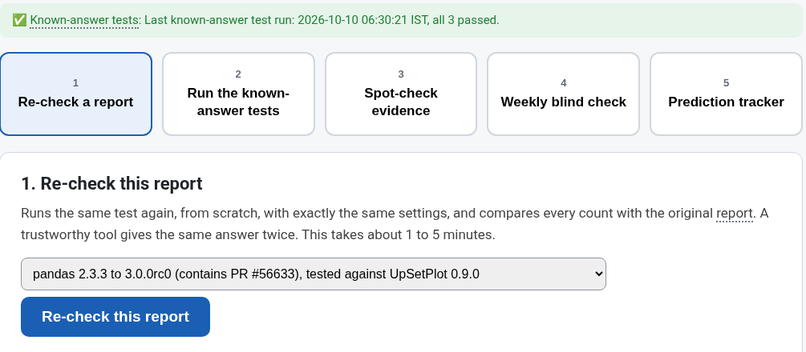
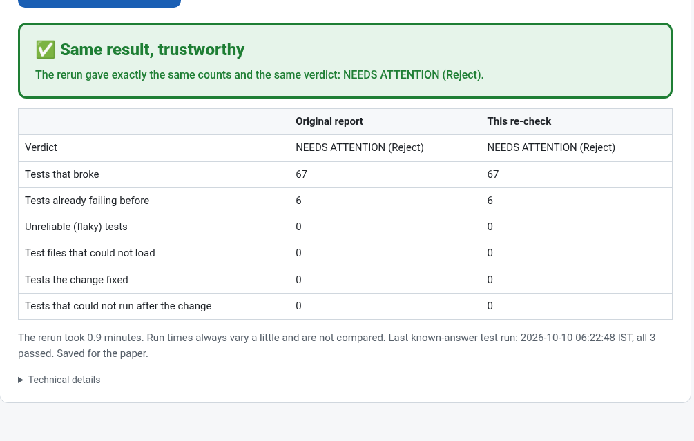
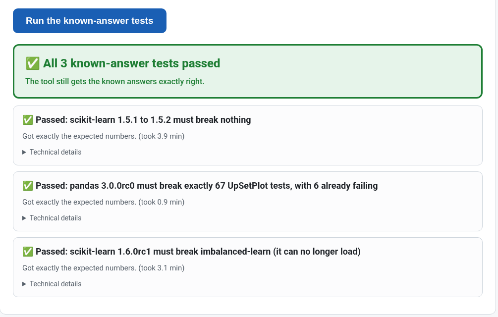
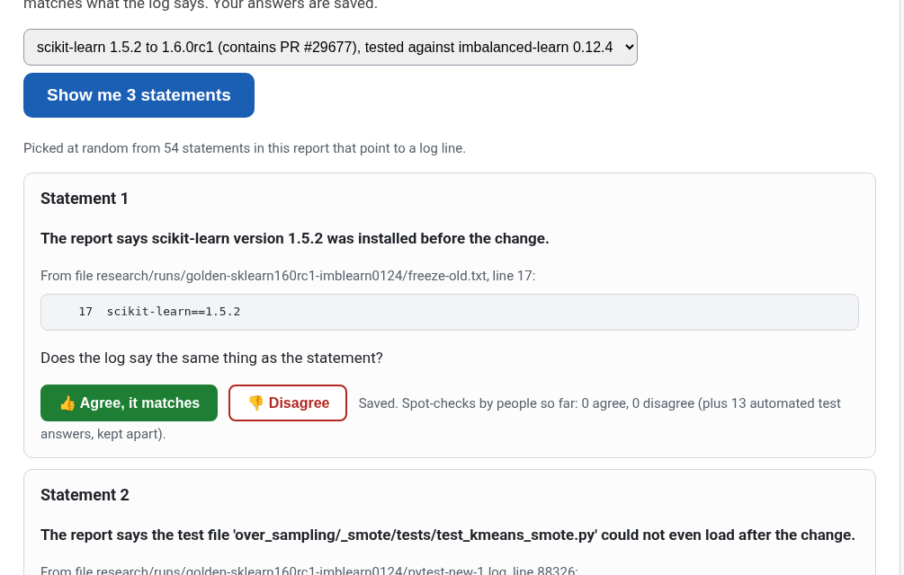
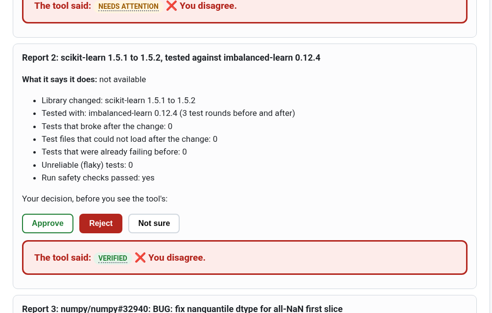
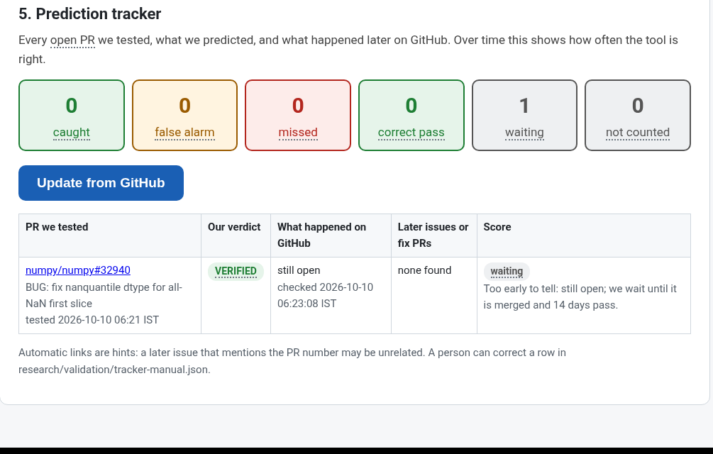

<!-- Copied from Jonathan's research folder (blast-radius-research/docs/VALIDATION_GUIDE_FOR_NON_TECH.md, 10 Oct 2026). -->

> **Written by Jonathan.** Copied into this repo on 10 Oct 2026 from his research folder on the shared machine. The
> Validation Center itself lives in that folder (`/workspace/blast-radius-research`), not in this repo, and runs only
> on the shared machine. **How it connects to this repo:** button 2 (known-answer tests) writes
> `research/validation/golden-status.json`. Every report this repo makes reads that file, and if the latest replay
> failed, the report says **COULD NOT VERIFY / Re-run** until it passes again (see the README, section 5).

# Validation Center: a 1-page guide

The Validation Center checks whether Proof-of-Change gives true answers. It never posts anything online and never changes a report. Everything you answer is saved for the paper in `research/validation/`.

## How to open the Validation Center

It runs on the project computer (the "box"), where the tests and logs are. In a terminal on that computer, type `cd /workspace/blast-radius-research`, then `./validate-web`, and press Enter. When the window says "Validation Center is running", open **http://127.0.0.1:8765** in the web browser **on that same computer**, and leave the terminal window open while you use it. If you'd rather not use a browser, type `./validate` instead and choose 1 to 5 from the menu.

## The 5 buttons

| Button | What it does | What a good result looks like | Time |
|---|---|---|---|
| 1. Re-check a report | Pick a report and run its tests again from scratch | ✅ "Same result, trustworthy". A ❌ lists exactly what differs | 1 to 5 min |
| 2. Known-answer tests | Reruns 3 cases where we already know the right answer | ✅ "All 3 known-answer tests passed". If any fails, every report shows COULD NOT VERIFY until they pass again | about 6 min |
| 3. Spot-check evidence | Shows 3 random statements from a report next to the real log lines | You press 👍 Agree when the log says the same thing | 2 min |
| 4. Weekly blind check | Shows up to 5 reports with the verdict hidden. You choose Approve, Reject or Not sure, then it reveals the tool's verdict | You and the tool mostly agree. The agreement rate is saved | 10 min, once a week |
| 5. Prediction tracker | Lists the open PRs we tested and what later happened on GitHub | Many "caught" and "correct pass", few "false alarm" and "missed" | 1 to 2 min |

Long checks show a moving circle and a plain message such as "Step 2 of 3: running the tests". That's normal: just wait. Words with a dotted underline explain themselves when you point at them. If something goes wrong you'll see a short message. The "Technical details" fold underneath is for Jonathan or Nathan.

## Screenshots

| | |
|---|---|
|  |  |
| Start page | Button 1: same result, trustworthy |
|  |  |
| Button 2: all 3 known answers passed | Button 3: a statement next to its log line |
|  |  |
| Button 4: verdicts revealed after you choose | Button 5: what happened later on GitHub |

## Good habits

- Run button 2 once a day, and before you trust any new report.
- Run button 4 once a week, on a fresh set of reports.
- If a re-check says ❌, don't use that report. Send the list of differences to Jonathan or Nathan.
