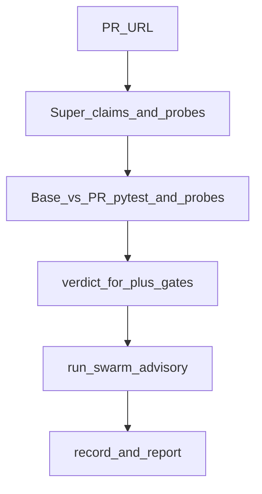

# Hackathon audit — Proof-of-Change

**Date:** 2026-10-17  
**Branch:** `cursor/hackathon-submission-prep-81ec`  
**Commit at audit start:** see git log on this branch  
**Official rules checked:** [Nebius × NVIDIA Global AI Hackathon](https://nebiusglobalaihackathon.devpost.com/rules) (Devpost)

## Existing architecture and agent responsibilities

| Role / stage | Model (default) | When | Influences verdict? | Notes |
|---|---|---|---|---|
| Claims | `nvidia/nemotron-3-super-120b-a12b` | Before dual-run | Indirectly (drives probes) | [`poc/model_probes.py`](../poc/model_probes.py) |
| Probes | same Super | Before / with dual-run | **Yes** — probe diffs + AI-probe/coverage gates | Validated, frozen, sandboxed |
| Code verdict | n/a (deterministic) | After compare | **Authoritative** | [`poc/verdict.py`](../poc/verdict.py), gates in `ops/daily_run.py` |
| Judge (Ultra) | `nvidia/Nemotron-3-Ultra-550b-a55b` | After verdict | **No** (advisory labels) | [`poc/agents.py`](../poc/agents.py) `run_swarm` |
| Helper (Lightning → Nano) | `nvidia/Nemotron-3_5-Lightning` / Nano fallback | After verdict | **No** | Sequential after judge |
| Summary (Super) | Super 120B | After verdict | **No** | Quotes filtered to record excerpt |

**Invocation:** sequential swarm (judge → helper → summary), not parallel. Providers: `nebius` | `recorded` | `none` via [`poc/model_provider.py`](../poc/model_provider.py). Endpoint: `https://api.tokenfactory.nebius.com/v1`. Auth: `NEBIUS_API_KEY` in orchestrator only (never in sandbox env).

**Ablation baselines already in tree** ([`evals/ablation.py`](../evals/ablation.py)): `tests` | `tests+diff` | `tests+probes` | `full`. Mission A/B/C maps to `tests` / `tests+probes` / `full` (+ advisory swarm when a provider is on). Ultra does **not** feed the score (ADR [`docs/decisions/2026-10-16-nemotron-agent-swarm.md`](../docs/decisions/2026-10-16-nemotron-agent-swarm.md)).

## Verified versus unverified capabilities

| Claim | Status |
|---|---|
| Dual-run pytest + deterministic compare | **Verified** (golden fixtures + unit tests) |
| Super claims/probes can catch tests-pass regressions (mlxtend#1229) | **Verified** offline via golden_pr + recorded fixture |
| Advisory Ultra/Lightning/Super swarm | **Verified** (`tests/test_agents.py`, recorded fixture) |
| Live Nebius Token Factory inference in this environment | **Unverified this run** — `NEBIUS_API_KEY` unset at audit time |
| Contree remote sandboxes | **Unverified** without `NEBIUS_PROJECT_ID` + contree-sdk |
| Hosted public console URL | **Unverified** — no fixed URL in repo; deploy awaits approval |
| Local bubblewrap isolation | **Verified** in tests when `bwrap` installed |
| Hosted Render path without Contree uses `--unsafe-no-sandbox` | **Verified** in code (`console_run_flags`) |
| Daily `NebiusProvider` through `GatedProvider` leakage firewall | **Gap** — gate used by PatchGuru path; daily provider still implements `complete_json` directly |
| Verified labelled *safe* PR for blind FPR | **Gap** — `safe-TODO-1` still TODO |

## Commands run and outcomes

| Command | Outcome |
|---|---|
| `make setup` | OK after installing `python3.12-venv` |
| `sudo apt-get install bubblewrap` | Required so sandbox tests collect |
| `make test` | **Partial:** ruff OK; guardrails OK; **697 passed, 13 skipped, 2 failed** |
| Failures | `tests/test_reports.py::test_uncited_claim_lowers_confidence`, `test_pdf_rendered` — headless Chrome PDF timeout (180s) in this VM |
| `python -m evals.run_evals --observations evals/fixtures/golden_v1.jsonl --require-golden --require-v1` | **APPROVE** (`pass: 28`, `skip: 3`) |

## Current test failures and known limitations

1. **Chrome PDF generation** hangs/times out in this cloud agent image — HTML/MD reports still work; PDF is optional for demos.
2. **No live Nebius key** in the agent environment at audit time — live ablation and live demo path blocked until key is exported.
3. **Labelled safe PRs** missing → blind false-alarm rates on PR ablation stay thin.
4. **Post-verdict swarm is advisory** — do not market as collaborative/adversarial/parallel/self-correcting; it is sequential role-routed labeling and summary.
5. **Render/hosted demos** may run with `--unsafe-no-sandbox` unless Contree is configured — must be labelled in the UI.

## Hackathon eligibility gaps

Checked against official Devpost rules (submission period through 2026-10-30 PT):

| Requirement | Status |
|---|---|
| Track fit | **Coding and Agentic Engineering** (primary) — agents that run/test code |
| Runtime call to Nebius Token Factory **or** Nebius AI Cloud | Code ready; **live call needs key** |
| ≥1 NVIDIA open-source model (Nemotron) | Configured model IDs in `DEFAULT_MODELS` |
| Public repo + open-source license | MIT (`LICENSE`) |
| README with setup + Nemotron/Token Factory highlight | Present; judge-facing polish in progress |
| Working demo URL | **Blocker** until deploy approved (local + recorded path works) |
| Public YouTube video ≤3 minutes | **Blocker** — placeholder script only until recorded |
| Feedback on Nebius/NVIDIA tools in submission form | Human must fill on Devpost |
| Significant updates during submission period (if pre-existing) | Document hackathon delta in README |

## Ranked improvements (judging impact × risk × effort)

1. **Judge UX honesty** (live vs recorded badge, one-click mlxtend sample, sandbox `run_note`) — high Design / trust, low risk, small effort.
2. **Evidence-backed eval write-up** from golden baselines + recorded fixture; live Nebius when key available — high Tech Implementation / Idea, medium effort.
3. **README judge path + eligibility checklist + deploy proposal** — high Impact presentation, low risk.
4. **Surface Contree/unsafe sandbox mode** — safety honesty, low effort.
5. **Wire daily provider through `GatedProvider`** — correctness, medium risk → **defer** (document gap).
6. **Hosted demo deploy** — required for form; **awaiting human approval** (decision 2B).

## Phase log

| Phase | Result |
|---|---|
| 1 Recon + baseline | This document; `make test` partial (Chrome PDF); golden evals APPROVE |
| 2 Swarm validate | Advisory contract confirmed (`tests/test_agents.py`); `GatedProvider` daily wiring deferred as gap; job now stores `model_provider` / `run_note` |
| 3 Evaluation | Offline A/B/C via golden_pr mlxtend; live ablation blocked (no key). See `AGENT_SWARM_EVALUATION.md` |
| 4 Safety | Documented Contree vs unsafe fallback; console surfaces `run_note` |
| 5 Judge UX | Sample button, live/fixture badges, sandbox banner |
| 6 Demo | `DEMO_SCRIPT_3MIN.md` (mlxtend#1229) |
| 7 Docs | README judge section + security note |
| 8 Assets | `SUBMISSION_CHECKLIST.md` + deploy proposal (not executed) |
